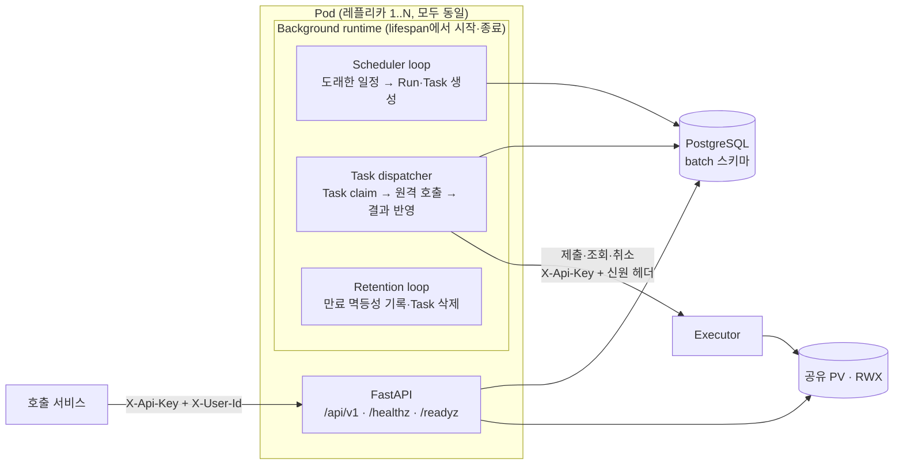
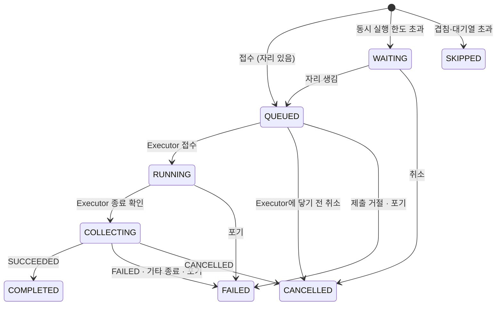

# pr-batch 목표 아키텍처 (배포 제약 반영)

상태: 구현됨. 기능 요건은 [요구사항](requirements.md), 도메인 용어는 [서비스 체계](domain-model.md),
API 계약은 각 API 안내를 따른다.

## 1. 배포 제약과 그 의미

| 제약 (2026-10-13 확인) | 설계에 주는 의미 |
| --- | --- |
| 사내 온프렘 SaaS형 k8s | 표준 Deployment·Service·Secret·PVC 범위에서 동작해야 함 |
| 1레포 1서비스 (한 레포로 Deployment 하나) | API·스케줄러·워커를 **별도 Deployment로 나눌 수 없음**. 한 이미지가 모든 역할 수행 |
| 멀티컨테이너 파드 불가 | 사이드카·별도 워커 컨테이너·(아마) migration init container 불가 |
| CPU 사용률 기반 HPA 강제 | 레플리카 수가 1..N으로 **언제든 늘고 줄어듦**. 모든 레플리카가 같은 일을 해도 안전해야 하고, 스케일 인 시 작업이 중간에 끊겨도 복구돼야 함 |

결론적으로 지금 구조(API·Executor 워커·스케줄러를 각각 다른 프로세스로 띄우는 방식)는
그대로 배포할 수 없다. 한 컨테이너 안에 프로세스 여러 개를 띄우는 방식(supervisord 등)도
헬스체크와 HPA 신호가 프로세스 하나만 반영해 장애를 숨기므로 쓰지 않는다.

참고: 같은 플랫폼에 올라가는 Executor도 API와 워커를 한 프로세스 안에서 함께 돌리고,
시작 시 자동 migration(`DB_AUTO_MIGRATE`)을 한다.

## 2. 핵심 결정

**한 이미지, 한 프로세스, 대칭형 레플리카.** 각 Pod는 FastAPI(HTTP API)와 내장
백그라운드 런타임(스케줄러 루프 + 작업 처리기)을 같은 프로세스에서 돌린다. 모든 레플리카가
똑같고 리더가 없다. 레플리카 사이의 조정은 전부 PostgreSQL 잠금으로 한다.

| 대안 | 판단 |
| --- | --- |
| API·스케줄러·워커 별도 Deployment | 1레포 1서비스 제약으로 불가 |
| Celery/RQ + Redis 브로커 | 워커를 별도 Deployment로 띄우는 구조가 전제. 같은 프로세스에서는 이점 없이 인프라만 추가 |
| APScheduler 같은 메모리 스케줄러 | 레플리카마다 같은 일정을 중복 실행. 분산 잠금을 따로 만들어야 하고 재시작 시 상태 유실 |
| k8s CronJob | 사용자별로 동적으로 생기는 일정에 맞지 않고, 레포당 리소스 제약에도 걸림 |
| **PostgreSQL 기반 내장 작업 큐 + 스케줄러 루프 (채택)** | 추가 인프라 없음, 레플리카 수와 무관하게 정확히 한 번 접수, 장애·스케일 인 복구가 DB lease로 해결 |

## 3. 런타임 구성

`uvicorn` 워커 1개(프로세스 1개)로 실행한다. 확장은 프로세스 수가 아니라 HPA 레플리카로 한다.

| 구성 요소 | 동작 |
| --- | --- |
| HTTP API | 등록·조회·수동 실행 접수. 원격 서비스를 직접 호출하지 않고 DB에 기록만 함 |
| Scheduler loop | 1초 주기. 도래한 배치 하나를 `FOR UPDATE SKIP LOCKED`로 잡아 Run과 첫 Task를 같은 트랜잭션으로 생성. 여러 레플리카가 동시에 돌아도 같은 예약을 두 번 만들지 않음 |
| Task dispatcher | 스레드 풀(Pod당 동시성 `TASK_CONCURRENCY`, 기본 4). Task를 lease로 claim → DB 트랜잭션 밖에서 원격 호출 1회 → lease token 확인 후 결과 반영 + 다음 Task 예약 |
| Retention loop | 한 시간마다 만료된 멱등성 기록과 끝난 Task를 삭제 (4.1) |
| Heartbeat | 루프마다 마지막 활동 시각을 메모리에 기록. liveness가 이 값을 봄 |

현재 코드의 동기 SQLAlchemy·HTTP 클라이언트는 그대로 쓰고, 백그라운드 작업은 스레드에서
돌려 API 이벤트 루프를 막지 않는다. 처리량 규모(사용자 100~200명)에서 async 전환 이득보다
복잡도가 크다.

## 4. 실행 파이프라인과 상태 머신

사용자에게 보이는 상태는 `run.status` 하나이고, 상태 집합은 `domain/run_state.py`에 있다.
Executor 원본 상태(`execution_status`), 실패 유형(`failure_type`), 노트북 projection 상태 등
세부 값은 별도 컬럼으로 보존한다.

- 겹침 판단의 "점유"는 QUEUED·RUNNING이다(요건: 코드 실행 종료 기준). 결과 수집은 다음 실행을 막지 않는다.
- Executor는 결과 노트북 projection과 Artifact 등록이 끝난 뒤에만 SUCCEEDED를 보고하므로
  COLLECTING은 결과 조회 한 번으로 끝난다. 결과 리포트는 pr-agentic-service가 Executor 이벤트로 만든다.
- 원격 호출이 `TASK_GIVE_UP_SECONDS`(기본 24시간) 동안 계속 실패하면 Run을 FAILED
  (`failure_type=ABANDONED`)로 끝내 자리를 비운다. Executor 쪽 실행은 남아 있을 수 있다.

Task 종류:

| kind | 원격 호출 | 다음 |
| --- | --- | --- |
| SUBMIT_EXECUTION | Executor `POST /executions` (멱등성 키 `batch-run:<run_id>:submit`) | SYNC_EXECUTION, 취소 요청이 있으면 CANCEL_EXECUTION |
| SYNC_EXECUTION | Executor 상태 조회 | 진행 중이면 간격을 두 배로 늘려 자신을 재예약, 종료면 COLLECT_RESULT |
| COLLECT_RESULT | Executor 결과 조회 | Run 종료 |
| CANCEL_EXECUTION | Executor 취소 (멱등성 키 `batch-run:<run_id>:cancel`) | 없음. SYNC_EXECUTION이 CANCELLED를 관찰 |

`tasks` 테이블: `id, kind, run_id, payload, run_at, attempts, lease_owner, lease_until, token,
last_error, failing_since, status`. claim은 `FOR UPDATE SKIP LOCKED`, 반영은 lease `token`이
일치할 때만 한다(늦게 끝난 옛 Pod의 쓰기 차단). 통신 오류는 지수 backoff + jitter로 재시도하고,
첫 실패 시각(`failing_since`)부터 포기 한도를 잰다. 성공하면 시도 횟수와 `failing_since`를 초기화한다.

제출 응답을 받지 못한 경우(타임아웃, 5xx 등) Executor에 실행이 생겼을 수 있으므로 Task payload에
`uncertain` 표시를 남긴다. 이후 거절 응답도 "생성되지 않음"의 증거가 아니므로 재시도하고, 그 사이
취소 요청이 들어오면 같은 키로 재제출해 실행을 확인한 뒤 취소한다.

**Run 상태와 Task의 역할 분담 (트랜잭션 outbox 방식)**:
- **Run 상태가 유일한 진실**이다. "지금 어디까지 왔나"는 Run만 보고 판단한다.
- 상태를 바꾸는 트랜잭션 안에서 그 결과로 해야 할 외부 호출을 Task로 함께 넣는다.
  상태 변경과 Task 생성이 같이 커밋되거나 같이 롤백되므로 둘이 어긋나지 않는다.
- Task handler는 실행 전에 Run 상태를 확인해, 이미 지난 단계의 Task(재전송·중복)면 아무것도 하지 않고 끝낸다.
- 알림처럼 별도 API를 호출하는 부가 작업은 handler 하나를 추가하는 것으로 끝나고, 본 실행 흐름은 바뀌지 않는다.

## 4.1 보존 정리

`retention` 루프가 한 시간마다 만료 행을 1000건씩 지운다. 실행 이력(`batch_runs`)은 지우지 않는다.

| 대상 | 기준 | 설정 |
| --- | --- | --- |
| 멱등성 기록 | 생성 후 7일 | `IDEMPOTENCY_RETENTION_DAYS` |
| 끝난 Task(`DONE`) | 생성 후 30일 | `TASK_RETENTION_DAYS` |

## 5. HPA·스케일 인/아웃 대응

**CPU HPA는 이 서비스의 실제 부하를 잘 반영하지 못한다.** 노트북 실행은 Executor가 하고,
pr-batch의 백그라운드 일은 대부분 네트워크 대기라 CPU가 거의 오르지 않는다. 그래서:

- 처리량은 레플리카 수가 아니라 **Pod당 동시성 설정과 Executor 쪽 한도**로 관리한다.
  레플리카가 늘면 처리량도 같이 늘지만, 늘지 않아도 정상 동작하도록 설계한다.
- HPA 값: `minReplicas: 1`(기본 Pod 1개. 재시작하는 수십 초 동안 API가 멈추고 예약이 늦어지지만, 놓친 예약은
  misfire 규칙대로 처리돼 유실은 없다), `maxReplicas: 4`,
  CPU 목표 70%. 업로드 검증처럼 CPU를 쓰는 API 요청이 몰릴 때만 늘어나는 것이 정상이다.
- 레플리카가 늘어도 DB 부하가 폭주하지 않게 루프는 유휴 시 sleep, 조회는 backoff·jitter를 쓰고,
  커넥션 수는 아래 9장 예산을 넘지 않게 한다.

스케일 인·롤링 배포 시 종료 순서 (SIGTERM 수신):

1. readiness를 실패로 바꿔 새 요청 유입 차단.
2. 스케줄러·dispatcher가 새 claim을 멈춤.
3. 진행 중인 원격 호출(최대 HTTP timeout 30초)을 끝내고 반영.
4. 끝내지 못한 Task는 lease 만료 후 다른 Pod가 이어받음. Executor 제출은 멱등성 키라 중복 실행이 없음.

`terminationGracePeriodSeconds: 60`, lease 90초를 기본으로 한다.

## 6. DB migration

별도 Job·init container를 쓸 수 없고, 배포된 Pod 쉘에서 스크립트를 돌리는 방식은 지양해야
하므로 **앱 시작 시 자동 migration**으로 바꾼다(현재는 앱이 migration을 하지 않는 정책).
Pod 쉘에서 `alembic upgrade head`를 수동 실행하는 것은 장애 복구용 비상 수단으로만 문서화한다.

- `DB_AUTO_MIGRATE=true`이면 시작 시 PostgreSQL advisory lock을 잡고 `alembic upgrade head`.
  여러 Pod가 동시에 떠도 한 Pod만 수행하고 나머지는 기다림.
- `batch` 스키마가 없을 때만 만든다. DBA가 스키마를 미리 만들고 앱 계정에 그 스키마의 소유권(또는 USAGE·CREATE)만
  주면, 앱 계정에 DB 수준 CREATE 권한은 필요 없다.
- 롤링 배포 중에는 옛 버전과 새 버전 Pod가 잠시 공존하므로 운영 이후의 migration은 "추가 → 코드 전환 →
  제거" 순서(expand/contract)로 나눠, 직전 버전 코드와 호환되게 작성한다.
  - 한 배포에서 하는 것: 테이블·nullable 컬럼·인덱스 추가, 기본값 있는 컬럼 추가.
  - 다음 배포로 미루는 것: 컬럼·테이블 삭제, 이름 변경, NOT NULL 추가, 타입 축소. 그 컬럼을 안 쓰는 코드가
    먼저 운영에 나간 뒤에 한다.
- **새 버전이 이미 올린 DB에서 옛 코드가 떠도 된다.** 옛 코드는 모르는 revision을 "더 새 버전"으로 보고 migration을
  건너뛰며(`migrations/env.py`), readiness도 통과한다. 그래서 롤링 배포 중의 옛 Pod와 이미지 롤백이 막히지 않는다.
  이 동작은 위 호환 규칙이 지켜진다는 전제다.
- 운영 전이라 migration은 `0001_initial` 하나로 합쳐 두었다. 기존 개발 DB는 `batch` 스키마를 지우고 다시 만든다.
- migration이 끝나기 전에는 readiness가 실패한다. DB가 이 코드가 아는 옛 revision이거나 비어 있을 때만 실패한다.

## 7. 헬스체크

| 엔드포인트 | 용도 | 검사 |
| --- | --- | --- |
| `/healthz` | liveness | 프로세스 응답 + 백그라운드 루프 heartbeat가 최근(예: 60초 이내)인지. 루프가 죽었으면 재시작되게 함 |
| `/readyz` | readiness | DB 연결, DB revision이 이 코드의 head이거나 그보다 새 버전(모르는 revision), PV 마운트, 종료 중 아님 |

## 8. 외부 연동

- **Executor**: **이벤트 구독 없이 조회(polling)로 시작한다.** Executor Redis 접근은 가능하지만
  별도 consumer group을 만들 분명한 사유가 아직 없다.
  - 조회 대상은 등록된 배치 수가 아니라 **지금 실행 중인 Run 수**다. 조회 간격은 5초에서 시작해
    두 배씩 늘려 최대 60초(설정 가능)로 둔다. 배치 500개가 같은 시각에 10분짜리 실행을 시작하는
    최악의 경우에도 Run당 조회는 약 13회, 평균 초당 11건 수준이다.
  - Executor 상태 조회(`GET /executions/{id}`)는 기본키 한 행을 필요한 컬럼만 읽는 비동기 핸들러다
    (`executor/src/executor_service/infrastructure/_execution_queries/executions.py`). 초당 수십 건은 부하가 아니다.
  - pr-batch가 Executor에 동시에 보내는 요청은 `Pod 수 × dispatcher 동시성`(최대 4 × 4 = 16)을 넘지 않는다.
    Run이 아무리 많아도 Executor가 받는 동시 요청은 이 상한으로 묶인다.
  - 종료 감지 지연은 최대 조회 간격(60초) + 큐 대기다. 처리 용량(Pod당 초당 수십 건)이 필요량보다 훨씬 커서
    수십 분씩 밀리는 일은 없다.
  - 이벤트 구독은 Redis 의존성, consumer group 운영, 순서·누락 복구 로직(어차피 polling이 필요)을
    추가한다. 지금 얻는 것은 종료 감지가 최대 수십 초 빨라지는 것뿐이다.
  - 도입 기준을 미리 정해 둔다: 동시 RUNNING이 수백 개를 넘어 조회가 Executor·DB 부하가 되거나,
    종료 직후 처리 같은 지연 요건이 생기면 pr-batch 전용 consumer group으로
    `executor.events`를 구독해 조회를 깨우는 신호로만 쓴다. 이때도 polling은 누락 복구용으로 남긴다.
- **공유 PV**: 모든 레플리카가 같은 볼륨을 쓰므로 **ReadWriteMany** PVC를 Executor와 공유한다
  (공유 가능 확인됨). Executor 입력 루트와 같은 상대경로가 보여야 하고, 두 서비스 모두 UID 1000.

## 9. DB 커넥션 예산

자원이 넉넉하지 않으므로 **원격 호출 중에는 DB 커넥션을 잡지 않는 것**을 원칙으로 한다.
Task 하나는 "짧은 claim 트랜잭션 → 커넥션 반납 → 원격 호출 → 짧은 반영 트랜잭션"으로 처리하므로
동시에 처리 중인 Task가 많아도 실제 커넥션 사용은 순간적이다.

| 항목 | 제안값 | 근거 |
| --- | --- | --- |
| Pod당 SQLAlchemy 풀 | `pool_size=5`, `max_overflow=5` (최대 10) | API 요청 + 백그라운드 루프 6개(스케줄러 1, dispatcher 4, 보존 정리 1) |
| Pod당 dispatcher 동시성 | 4 | 원격 호출 대기 중에는 커넥션 미사용 |
| 레플리카 | 평소 1, 최대 4 | HPA 값 |
| **pr-batch 전체 상한** | **40** (4 × 10), 평소 실사용 2~10 | DB role에 `CONNECTION LIMIT 40` 설정 권장 |

효율을 위한 장치:
- 유휴 시 스케줄러는 "다음 예약 시각까지" 또는 최대 5초까지 잠들고, dispatcher는 다음 Task
  예정 시각(`min(run_at)`)까지 잠든다. 할 일이 없을 때 초당 쿼리가 거의 없다.
- claim은 한 번에 Task 여러 개(동시성 여유만큼)를 가져와 쿼리 수를 줄인다.
- `LISTEN/NOTIFY`처럼 Pod마다 커넥션을 계속 점유하는 방식은 쓰지 않는다.
- 풀 크기·동시성은 환경변수로 바꿀 수 있게 하고, 부하 측정 후 조정한다.

## 10. 인증 (2026-10-29 변경)

| 구간 | 방식 |
| --- | --- |
| 사용자 → pr-agentic-service | SSO (pr-agentic-service 책임) |
| 호출 서비스 → pr-batch | 호출자별 API key(`X-Api-Key`) + 사용자 헤더(`X-User-Id`, 선택 `X-Project-Id`·`X-Tenant-Id`). pr-batch는 key의 SHA-256만 `AUTH_CLIENTS`에 둔다 |
| pr-batch → Executor | pr-batch의 Executor key(`EXECUTOR_API_KEY`) + 실행 스냅샷의 `X-User-Id`·`X-Tenant-Id`·`X-Project-Id` |

JWT(RS256)를 쓰지 않게 된 이유는 다음과 같다.
- 운영 클러스터는 NetworkPolicy를 강제할 수 없고 Kubernetes Secret도 쓸 수 없어, 비밀은 어차피 레포 설정에 들어간다.
  개인키를 레포·이미지에 두는 JWT는 API key에 비해 실질적인 보안 차이가 작고, 키 쌍 발급·교체 비용만 크다.
- 호출 서비스(상위 에이전트, 다른 서비스)가 늘어날 예정이라 등록이 쉬운 방식이 필요하다.
- pr-batch, Executor, pr-agentic-service가 같은 헤더·설정 형식(`tenant`, `relay`, `allowed_tenants`, `admin`)을 쓴다.

자원은 Executor와 같이 **tenant + 사용자**로 소유한다(스크립트·배치·실행·멱등성 기록, PV 경로
`batch/inputs/tenants/{tenant}/users/{user}/…`). 다른 tenant의 자원은 404다.
tenant와 project는 등록할 때 정해지고 바꿀 수 없다. 실행을 만들 때 스냅샷에 고정되므로, 배치를 고쳐도 진행 중인
실행의 Executor 호출 신원은 바뀌지 않는다. 실행 완료는 Executor 이벤트가 아니라 `GET /executions/{id}` 폴링으로 안다.
나중에 사내 표준(mTLS, OIDC 등)이 정해지면 `app/core/security.py` 경계에서 교체한다.

호출 서비스의 구현 방법은 [호출 서비스 인증 가이드](client-auth.md)에 있다.

## 11. 결정 사항 (2026-10-13 답변)

| 질문 | 답변 | 반영 |
| --- | --- | --- |
| init container | 금지. Pod 쉘 수동 스크립트는 가능하지만 지양 | 앱 시작 시 advisory lock 자동 migration (6장) |
| Executor Redis | 접근 가능. 구독하려면 별도 consumer group + 분명한 사유 필요 | 초기엔 구독 안 함, 도입 기준 명시 (8장) |
| HPA min/max | 지정 가능 | min 1, max 4, CPU 70% (5장) |
| PVC 공유 | 가능 | Executor와 RWX PVC 공유 (8장) |
| DB 커넥션 | 직접 설정 가능, 자원 넉넉하지 않음 | 전체 상한 24, 원격 호출 중 커넥션 미점유 (9장) |
| 서비스 인증 | Executor 없음. prj_re는 SSO 필수, 나머지는 변경 요청 가능 | 서비스 간 단기 JWT → 2026-10-29 API key + 신원 헤더로 변경 (10장) |

## 12. 여러 인스턴스 검증 (2026-10-13)

`make docker-multi`로 같은 이미지의 app 3개를 한 DB에 띄우고(lease 30초로 단축)
`scripts/multi_instance_check.py`로 확인했다. 로컬 Executor BATCH 풀에서 실제로 실행했다.

| 시나리오 | 결과 |
| --- | --- |
| 같은 시각 ONCE 예약 30건 | 배치마다 Run 1개, Executor 실행 30개(멱등성 키 중복 0). 3개 인스턴스가 제출을 10/11/9건 분담 |
| 제출 중 lease를 쥔 인스턴스를 멈춤(`docker pause`) 후 강제 종료(SIGKILL) | 멈춘 시점에 lease 8건 보유. 30초 뒤 다른 인스턴스가 회수해 30건 모두 COMPLETED, Executor 중복 실행 0 |
| 처리 중 인스턴스 정상 종료(SIGTERM) | 1초 안에 종료("Background runtime stopped"), 남은 lease 0, 30건 모두 COMPLETED |
| 빈 스키마에서 3개 동시 기동 | 1개만 migration 수행, 나머지는 advisory lock 대기 후 정상 기동 |
