# batch 논리 ERD

스키마 `batch` · PostgreSQL · DB revision `0005_audit_client` · 기준 소스 pr-batch main `e71019e` (2026-11-25) · 작성 2026-11-27 · v1.1

엔터티 9개, 속성 145개를 모두 적었다. 생성·수정·삭제 정보 같은 공통 속성도 엔터티마다 빠짐없이 적는다.

## 1. ERD

아래 그림은 Mermaid 코드로 직접 적은 ERD다. GitHub, GitLab, VS Code 같은 Mermaid 지원 뷰어에서 그림으로 보인다. 엔터티 9개의 속성 전부와 관계 10개가 들어 있다. 각 줄은 `값 종류 · 대응 컬럼 · 키 · 속성명` 순서다.

```mermaid
erDiagram
    Script ||--|{ ScriptVersion : "버전"
    Batch ||--|{ BatchConfig : "설정 이력"
    ScriptVersion ||--o{ BatchConfig : "실행 대상 버전"
    Batch ||--o{ Run : "실행"
    BatchConfig ||--o{ Run : "접수 당시 설정"
    ScriptVersion ||--o{ Run : "실행한 버전"
    Run ||--o{ Step : "셀 단계"
    Batch ||--o{ SkippedWindow : "생략 회차"
    BatchConfig ||--o{ SkippedWindow : "생략 당시 설정"
    Run |o--o{ Task : "외부 호출"
    Script {
        uuid id PK "스크립트 ID"
        text tenant_id "테넌트 ID"
        text owner_id "소유자 ID"
        text name "스크립트명"
        text type "스크립트 유형"
        number revision "리비전"
        number latest_version_number "최신 버전 번호"
        datetime deleted_at "삭제 일시"
        text deleted_by "삭제자"
        text deleted_by_client "삭제 클라이언트"
        datetime created_at "생성 일시"
        text created_by "생성자"
        text created_by_client "생성 클라이언트"
        datetime updated_at "수정 일시"
        text updated_by "수정자"
        text updated_by_client "수정 클라이언트"
    }
    ScriptVersion {
        uuid id PK "버전 ID"
        uuid script_id FK "스크립트 ID"
        number version_number "버전 번호"
        text filename "파일명"
        text original_path "원본 경로"
        text sha256 "원본 해시"
        text code_hash "코드 해시"
        number size_bytes "파일 크기"
        json cell_map "실행 셀 목록"
        json cell_list "전체 셀 목록"
        datetime created_at "생성 일시"
        text created_by "생성자"
        text created_by_client "생성 클라이언트"
        datetime updated_at "수정 일시"
        text updated_by "수정자"
        text updated_by_client "수정 클라이언트"
    }
    Batch {
        uuid id PK "배치 ID"
        text tenant_id "테넌트 ID"
        text owner_id "소유자 ID"
        text name "배치명"
        boolean enabled "활성 여부"
        datetime next_run_at "다음 예약 시각"
        number revision "리비전"
        number schedule_failures "예약 접수 실패 횟수"
        datetime schedule_retry_at "예약 접수 재시도 시각"
        number config_number "현재 설정 번호"
        text project_id "프로젝트 ID"
        text client "등록 클라이언트"
        text disabled_reason "비활성 사유"
        datetime disabled_at "비활성 일시"
        text disabled_by "비활성 주체"
        datetime deleted_at "삭제 일시"
        text deleted_by "삭제자"
        text deleted_by_client "삭제 클라이언트"
        datetime created_at "생성 일시"
        text created_by "생성자"
        text created_by_client "생성 클라이언트"
        datetime updated_at "수정 일시"
        text updated_by "수정자"
        text updated_by_client "수정 클라이언트"
    }
    BatchConfig {
        uuid batch_id PK, FK "배치 ID"
        number number PK "설정 번호"
        uuid script_id FK "스크립트 ID"
        uuid script_version_id FK "스크립트 버전 ID"
        json runtime "런타임"
        json schedule "일정"
        json policy "정책"
        datetime created_at "생성 일시"
        text created_by "생성자"
        text created_by_client "생성 클라이언트"
        datetime updated_at "수정 일시"
        text updated_by "수정자"
        text updated_by_client "수정 클라이언트"
    }
    Run {
        uuid id PK "실행 ID"
        uuid batch_id FK "배치 ID"
        text owner_id "소유자 ID"
        uuid script_id FK "스크립트 ID"
        uuid script_version_id FK "스크립트 버전 ID"
        number config_number FK "설정 번호"
        json runtime "런타임"
        json snapshot "접수 스냅샷"
        text trigger "실행 계기"
        datetime scheduled_for "예약 회차 시각"
        text status "상태"
        text skip_reason "생략 사유"
        boolean cancel_requested "취소 요청 여부"
        text cancel_source "취소 요청 주체"
        text cancel_reason "취소 사유"
        uuid execution_id "executor 실행 ID"
        uuid operation_id "executor 작업 ID"
        text execution_status "executor 상태"
        number observed_version "관찰 상태 버전"
        text failure_type "실패 유형"
        text notebook_status "결과 노트북 상태"
        json artifacts "산출물 목록"
        json attempts "시도 목록"
        json retry_info "재시도 정보"
        text last_error "마지막 오류"
        datetime submitted_at "제출 일시"
        datetime started_at "실행 시작 일시"
        datetime finished_at "실행 종료 일시"
        datetime observed_at "마지막 관찰 일시"
        datetime completed_at "완료 일시"
        datetime created_at "생성 일시"
        text created_by "생성자"
        text created_by_client "생성 클라이언트"
        datetime updated_at "수정 일시"
        text updated_by "수정자"
        text updated_by_client "수정 클라이언트"
    }
    Step {
        uuid run_id PK, FK "실행 ID"
        number sequence PK "실행 순서"
        number original_index "원본 셀 위치"
        text source_sha256 "셀 코드 해시"
        uuid step_id "executor step ID"
        text status "셀 결과 상태"
        json result_ref "결과 참조"
    }
    SkippedWindow {
        uuid id PK "생략 기록 ID"
        uuid batch_id FK "배치 ID"
        number config_number FK "설정 번호"
        datetime from_at "구간 시작"
        datetime until_at "구간 끝"
        number occurrences "생략 회차 수"
        text reason "생략 사유"
        datetime created_at "생성 일시"
        text created_by "생성자"
        text created_by_client "생성 클라이언트"
        datetime updated_at "수정 일시"
        text updated_by "수정자"
        text updated_by_client "수정 클라이언트"
    }
    Task {
        uuid id PK "작업 ID"
        text kind "작업 종류"
        uuid run_id FK "실행 ID"
        json payload "부가 정보"
        text status "상태"
        datetime run_at "실행 예정 시각"
        number attempts "연속 시도 횟수"
        uuid lease_token "lease 토큰"
        datetime lease_until "lease 만료 시각"
        text last_error "마지막 오류"
        datetime failing_since "연속 실패 시작 시각"
        datetime created_at "생성 일시"
    }
    IdempotencyRecord {
        text tenant_id PK "테넌트 ID"
        text owner_id PK "소유자 ID"
        text operation PK "작업"
        text key PK "멱등성 키"
        text request_hash "요청 지문"
        json response "첫 응답 본문"
        number status_code "첫 응답 코드"
        datetime created_at "생성 일시"
    }
```

같은 내용을 draw.io로 그린 원본은 `pr-batch_논리ERD_v1.1.drawio`다.

## 2. 엔터티 목록

| No | 엔터티 | 영문 | 주제 영역 | 설명 | 속성 수 |
|---|---|---|---|---|---|
| 1 | 스크립트 | Script | 스크립트 | 사용자가 업로드한 스크립트(노트북). 이름·유형과 버전 목록의 주인 | 16 |
| 2 | 스크립트 버전 | ScriptVersion | 스크립트 | 업로드한 원본 파일 하나에 해당하는 버전. 만든 뒤 바뀌지 않음(불변) | 16 |
| 3 | 배치 | Batch | 배치 | "이 스크립트 버전을 이 일정·정책으로 돌린다"는 등록. 일정·정책의 주인 | 24 |
| 4 | 배치 설정 이력 | BatchConfig | 배치 | 배치 실행 설정(버전·런타임·일정·정책)의 불변 스냅샷. 설정이 바뀔 때마다 다음 번호로 추가 | 13 |
| 5 | 실행 이력 | Run | 실행 | 배치의 실행 1회(Run). 접수 당시 설정과 executor 실행 결과 참조를 보존 | 36 |
| 6 | 실행 셀 단계 | Step | 실행 | Run 안의 코드 셀 1개와 executor step의 연결, 셀 결과 참조 | 7 |
| 7 | 생략 회차 기록 | SkippedWindow | 배치 | 실행하지 않고 넘긴 예약 구간. 구간과 건수 한 행으로 압축 | 13 |
| 8 | 내부 작업 큐 | Task | 내부 처리 | Run을 진행시키는 외부(executor) 호출 1건. 사용자에게 노출하지 않음 | 12 |
| 9 | 멱등성 기록 | IdempotencyRecord | 내부 처리 | 같은 Idempotency-Key로 재전송된 쓰기 요청에 첫 응답을 그대로 돌려주기 위한 기록 | 8 |

## 3. 관계

| No | 부모 엔터티 | 자식 엔터티 | 관계 | 카디널리티 (부모 : 자식) | 연결 속성 |
|---|---|---|---|---|---|
| 1 | 스크립트 | 스크립트 버전 | 버전 | 1 : 1..N | 스크립트 ID |
| 2 | 배치 | 배치 설정 이력 | 설정 이력 | 1 : 1..N | 배치 ID |
| 3 | 스크립트 버전 | 배치 설정 이력 | 실행 대상 버전 | 1 : 0..N | 스크립트 ID, 스크립트 버전 ID |
| 4 | 배치 | 실행 이력 | 실행 | 1 : 0..N | 배치 ID |
| 5 | 배치 설정 이력 | 실행 이력 | 접수 당시 설정 | 1 : 0..N | 배치 ID, 설정 번호 |
| 6 | 스크립트 버전 | 실행 이력 | 실행한 버전 | 1 : 0..N | 스크립트 ID, 스크립트 버전 ID |
| 7 | 실행 이력 | 실행 셀 단계 | 셀 단계 | 1 : 0..100 | 실행 ID |
| 8 | 배치 | 생략 회차 기록 | 생략 회차 | 1 : 0..N | 배치 ID |
| 9 | 배치 설정 이력 | 생략 회차 기록 | 생략 당시 설정 | 1 : 0..N | 배치 ID, 설정 번호 |
| 10 | 실행 이력 | 내부 작업 큐 | 외부 호출 | 0..1 : 0..N | 실행 ID |

멱등성 기록은 다른 엔터티와 관계가 없는 독립 엔터티다. 내부 작업(Task)은 대상 실행이 없을 수 있다(0..1).

## 4. 엔터티별 속성

키의 PK는 식별자, FK는 다른 엔터티 참조다. 필수의 Y는 값이 반드시 있어야 하는 속성이다.

### 4.1 스크립트 (Script)

사용자가 업로드한 스크립트(노트북). 이름·유형과 버전 목록의 주인. 속성 16개.

| No | 키 | 속성명 | 대응 컬럼 | 필수 | 설명 |
|---|---|---|---|---|---|
| 1 | PK | 스크립트 ID | `id` | Y | 스크립트 식별자. 앱에서 uuid4로 생성 |
| 2 |  | 테넌트 ID | `tenant_id` | Y | 소유 tenant. 생성 시 고정 |
| 3 |  | 소유자 ID | `owner_id` | Y | 소유 사용자(X-User-Id). 생성 시 고정 |
| 4 |  | 스크립트명 | `name` | Y | 표시 이름. 변경 가능 |
| 5 |  | 스크립트 유형 | `type` | Y | NOTEBOOK만 허용. 생성 시 고정 |
| 6 |  | 리비전 | `revision` | Y | 낙관적 잠금 번호(1 이상). 수정 API의 If-Match와 비교 |
| 7 |  | 최신 버전 번호 | `latest_version_number` | Y | 이 스크립트의 마지막 버전 번호 |
| 8 |  | 삭제 일시 | `deleted_at` |  | soft delete 시각. NULL이면 삭제되지 않은 상태 |
| 9 |  | 삭제자 | `deleted_by` |  | 삭제한 사용자(X-User-Id) |
| 10 |  | 삭제 클라이언트 | `deleted_by_client` |  | 삭제 요청에 쓰인 API key의 client 이름 |
| 11 |  | 생성 일시 | `created_at` | Y | 레코드 생성 시각 |
| 12 |  | 생성자 | `created_by` |  | 생성한 사용자(X-User-Id). 백그라운드 작업(스케줄러·dispatcher)이 만든 경우 NULL |
| 13 |  | 생성 클라이언트 | `created_by_client` |  | 생성 요청에 쓰인 API key의 client 이름. 백그라운드 작업은 NULL |
| 14 |  | 수정 일시 | `updated_at` | Y | 레코드 내용이 마지막으로 바뀐 시각. 스케줄러가 다음 예약 시각을 옮기는 것은 수정으로 보지 않음 |
| 15 |  | 수정자 | `updated_by` |  | 마지막으로 수정한 사용자(X-User-Id). 백그라운드 작업은 NULL |
| 16 |  | 수정 클라이언트 | `updated_by_client` |  | 마지막 수정 요청에 쓰인 API key의 client 이름. 백그라운드 작업은 NULL |

### 4.2 스크립트 버전 (ScriptVersion)

업로드한 원본 파일 하나에 해당하는 버전. 만든 뒤 바뀌지 않음(불변). 속성 16개.

| No | 키 | 속성명 | 대응 컬럼 | 필수 | 설명 |
|---|---|---|---|---|---|
| 1 | PK | 버전 ID | `id` | Y | 스크립트 버전 식별자 |
| 2 | FK | 스크립트 ID | `script_id` | Y | 소속 스크립트 |
| 3 |  | 버전 번호 | `version_number` | Y | 스크립트 안 순번(v1, v2 …, 1 이상) |
| 4 |  | 파일명 | `filename` | Y | 업로드 파일명(표시용) |
| 5 |  | 원본 경로 | `original_path` | Y | 공유 스토리지 안 원본 파일의 상대 경로 |
| 6 |  | 원본 해시 | `sha256` | Y | 원본 파일의 SHA-256. 다운로드 시 무결성 확인, 같은 내용 중복 업로드 방지 |
| 7 |  | 코드 해시 | `code_hash` | Y | 실행 코드만의 해시 |
| 8 |  | 파일 크기 | `size_bytes` | Y | 원본 크기(바이트) |
| 9 |  | 실행 셀 목록 | `cell_map` | Y | executor에 제출할 코드 셀 목록. [{original_index, sequence, path, sha256}] |
| 10 |  | 전체 셀 목록 | `cell_list` | Y | 원본의 모든 셀. [{index, type, executed, …}] |
| 11 |  | 생성 일시 | `created_at` | Y | 레코드 생성 시각 |
| 12 |  | 생성자 | `created_by` |  | 생성한 사용자(X-User-Id). 백그라운드 작업(스케줄러·dispatcher)이 만든 경우 NULL |
| 13 |  | 생성 클라이언트 | `created_by_client` |  | 생성 요청에 쓰인 API key의 client 이름. 백그라운드 작업은 NULL |
| 14 |  | 수정 일시 | `updated_at` | Y | 레코드 내용이 마지막으로 바뀐 시각. 스케줄러가 다음 예약 시각을 옮기는 것은 수정으로 보지 않음 |
| 15 |  | 수정자 | `updated_by` |  | 마지막으로 수정한 사용자(X-User-Id). 백그라운드 작업은 NULL |
| 16 |  | 수정 클라이언트 | `updated_by_client` |  | 마지막 수정 요청에 쓰인 API key의 client 이름. 백그라운드 작업은 NULL |

### 4.3 배치 (Batch)

"이 스크립트 버전을 이 일정·정책으로 돌린다"는 등록. 일정·정책의 주인. 속성 24개.

| No | 키 | 속성명 | 대응 컬럼 | 필수 | 설명 |
|---|---|---|---|---|---|
| 1 | PK | 배치 ID | `id` | Y | 배치 식별자. 앱에서 uuid4로 생성 |
| 2 |  | 테넌트 ID | `tenant_id` | Y | 소유 tenant. 등록 시 고정. executor에 제출할 때의 tenant이기도 함 |
| 3 |  | 소유자 ID | `owner_id` | Y | 소유 사용자(X-User-Id). 등록 시 고정 |
| 4 |  | 배치명 | `name` | Y | 표시 이름 |
| 5 |  | 활성 여부 | `enabled` | Y | 예약 실행 활성 여부. 등록 직후는 false |
| 6 |  | 다음 예약 시각 | `next_run_at` |  | 다음 예약 회차 시각. 비활성이면 반드시 NULL |
| 7 |  | 리비전 | `revision` | Y | 낙관적 잠금 번호(1 이상). 수정 API의 If-Match와 비교 |
| 8 |  | 예약 접수 실패 횟수 | `schedule_failures` | Y | next_run_at 회차의 예약 접수 실패 횟수 |
| 9 |  | 예약 접수 재시도 시각 | `schedule_retry_at` |  | 이 시각까지 스케줄러가 배치를 건너뜀 |
| 10 |  | 현재 설정 번호 | `config_number` | Y | 현재 적용 중인 설정(batch_configs.number) |
| 11 |  | 프로젝트 ID | `project_id` |  | 등록 시 X-Project-Id. 고정. NULL이면 프로젝트 범위 아님 |
| 12 |  | 등록 클라이언트 | `client` |  | 등록한 API key의 client 이름 |
| 13 |  | 비활성 사유 | `disabled_reason` |  | OWNER(소유자가 끔), USER_DEACTIVATED(사용자 일괄 비활성), TENANT_REVOKED(tenant 일괄 비활성). 활성이거나 켠 적 없으면 NULL |
| 14 |  | 비활성 일시 | `disabled_at` |  | 비활성화된 시각 |
| 15 |  | 비활성 주체 | `disabled_by` |  | 비활성화한 주체(client 이름) |
| 16 |  | 삭제 일시 | `deleted_at` |  | soft delete 시각. NULL이면 삭제되지 않은 상태 |
| 17 |  | 삭제자 | `deleted_by` |  | 삭제한 사용자(X-User-Id) |
| 18 |  | 삭제 클라이언트 | `deleted_by_client` |  | 삭제 요청에 쓰인 API key의 client 이름 |
| 19 |  | 생성 일시 | `created_at` | Y | 레코드 생성 시각 |
| 20 |  | 생성자 | `created_by` |  | 생성한 사용자(X-User-Id). 백그라운드 작업(스케줄러·dispatcher)이 만든 경우 NULL |
| 21 |  | 생성 클라이언트 | `created_by_client` |  | 생성 요청에 쓰인 API key의 client 이름. 백그라운드 작업은 NULL |
| 22 |  | 수정 일시 | `updated_at` | Y | 레코드 내용이 마지막으로 바뀐 시각. 스케줄러가 다음 예약 시각을 옮기는 것은 수정으로 보지 않음 |
| 23 |  | 수정자 | `updated_by` |  | 마지막으로 수정한 사용자(X-User-Id). 백그라운드 작업은 NULL |
| 24 |  | 수정 클라이언트 | `updated_by_client` |  | 마지막 수정 요청에 쓰인 API key의 client 이름. 백그라운드 작업은 NULL |

### 4.4 배치 설정 이력 (BatchConfig)

배치 실행 설정(버전·런타임·일정·정책)의 불변 스냅샷. 설정이 바뀔 때마다 다음 번호로 추가. 속성 13개.

| No | 키 | 속성명 | 대응 컬럼 | 필수 | 설명 |
|---|---|---|---|---|---|
| 1 | PK, FK | 배치 ID | `batch_id` | Y | 소속 배치 |
| 2 | PK | 설정 번호 | `number` | Y | 배치 안 설정 순번(1 이상) |
| 3 | FK | 스크립트 ID | `script_id` | Y | 실행 대상 스크립트 |
| 4 | FK | 스크립트 버전 ID | `script_version_id` | Y | 실행 대상 버전. script_id와 묶어 그 스크립트의 버전임을 보장 |
| 5 |  | 런타임 | `runtime` | Y | executor 런타임. {type, profile} |
| 6 |  | 일정 | `schedule` |  | 예약 일정. {definition, timezone, start_at, end_at}. NULL이면 수동 실행 전용 |
| 7 |  | 정책 | `policy` | Y | 겹침(overlap)·놓친 일정(misfire) 정책. {overlap, misfire} |
| 8 |  | 생성 일시 | `created_at` | Y | 레코드 생성 시각 |
| 9 |  | 생성자 | `created_by` |  | 생성한 사용자(X-User-Id). 백그라운드 작업(스케줄러·dispatcher)이 만든 경우 NULL |
| 10 |  | 생성 클라이언트 | `created_by_client` |  | 생성 요청에 쓰인 API key의 client 이름. 백그라운드 작업은 NULL |
| 11 |  | 수정 일시 | `updated_at` | Y | 레코드 내용이 마지막으로 바뀐 시각. 스케줄러가 다음 예약 시각을 옮기는 것은 수정으로 보지 않음 |
| 12 |  | 수정자 | `updated_by` |  | 마지막으로 수정한 사용자(X-User-Id). 백그라운드 작업은 NULL |
| 13 |  | 수정 클라이언트 | `updated_by_client` |  | 마지막 수정 요청에 쓰인 API key의 client 이름. 백그라운드 작업은 NULL |

### 4.5 실행 이력 (Run)

배치의 실행 1회(Run). 접수 당시 설정과 executor 실행 결과 참조를 보존. 속성 36개.

| No | 키 | 속성명 | 대응 컬럼 | 필수 | 설명 |
|---|---|---|---|---|---|
| 1 | PK | 실행 ID | `id` | Y | run_id |
| 2 | FK | 배치 ID | `batch_id` | Y | 소속 배치 |
| 3 |  | 소유자 ID | `owner_id` | Y | 배치 소유자(접수 시 복사) |
| 4 | FK | 스크립트 ID | `script_id` | Y | 실행한 스크립트 |
| 5 | FK | 스크립트 버전 ID | `script_version_id` | Y | 실행한 버전 |
| 6 | FK | 설정 번호 | `config_number` | Y | 접수 당시 설정 번호 |
| 7 |  | 런타임 | `runtime` | Y | 접수 당시 런타임. {type, profile} |
| 8 |  | 접수 스냅샷 | `snapshot` | Y | 접수 시 고정값. {script_id, script_version_id, sha256, code_hash, schedule, policy, tenant_id, project_id} |
| 9 |  | 실행 계기 | `trigger` | Y | SCHEDULED(예약), MANUAL(수동) |
| 10 |  | 예약 회차 시각 | `scheduled_for` |  | 예약 실행의 회차 시각. 수동 실행은 NULL |
| 11 |  | 상태 | `status` | Y | WAITING, QUEUED, RUNNING, COLLECTING, COMPLETED, FAILED, CANCELLED, SKIPPED |
| 12 |  | 생략 사유 | `skip_reason` |  | OVERLAP, SKIPPED_CAPACITY, OWNER_DEACTIVATED, TENANT_REVOKED |
| 13 |  | 취소 요청 여부 | `cancel_requested` | Y | 취소가 요청됐는지 |
| 14 |  | 취소 요청 주체 | `cancel_source` |  | USER(소유자), POLICY(겹침 정책 REPLACE) |
| 15 |  | 취소 사유 | `cancel_reason` |  | executor에 보낸 취소 사유 |
| 16 |  | executor 실행 ID | `execution_id` |  | executor가 발급한 execution ID |
| 17 |  | executor 작업 ID | `operation_id` |  | executor operation ID |
| 18 |  | executor 상태 | `execution_status` |  | executor 원본 상태. 종료 값은 SUCCEEDED, FAILED, CANCELLED |
| 19 |  | 관찰 상태 버전 | `observed_version` |  | 마지막으로 본 executor 상태 버전 |
| 20 |  | 실패 유형 | `failure_type` |  | SUBMIT_REJECTED, ABANDONED, 또는 executor가 준 실패 사유 코드 |
| 21 |  | 결과 노트북 상태 | `notebook_status` |  | 결과 노트북 projection 상태 |
| 22 |  | 산출물 목록 | `artifacts` | Y | executor artifact 목록(응답 그대로). 기본 [] |
| 23 |  | 시도 목록 | `attempts` | Y | executor 시도 목록(응답 그대로). 기본 [] |
| 24 |  | 재시도 정보 | `retry_info` |  | executor 재시도 정보(응답 그대로) |
| 25 |  | 마지막 오류 | `last_error` |  | 진행 중 마지막 통신·계약 오류 코드 |
| 26 |  | 제출 일시 | `submitted_at` |  | executor에 제출한 시각 |
| 27 |  | 실행 시작 일시 | `started_at` |  | executor가 보고한 실행 시작 시각 |
| 28 |  | 실행 종료 일시 | `finished_at` |  | executor가 보고한 실행 종료 시각 |
| 29 |  | 마지막 관찰 일시 | `observed_at` |  | executor 상태를 마지막으로 확인한 시각 |
| 30 |  | 완료 일시 | `completed_at` |  | batch에서 Run이 끝난 시각 |
| 31 |  | 생성 일시 | `created_at` | Y | 레코드 생성 시각 |
| 32 |  | 생성자 | `created_by` |  | 생성한 사용자(X-User-Id). 백그라운드 작업(스케줄러·dispatcher)이 만든 경우 NULL |
| 33 |  | 생성 클라이언트 | `created_by_client` |  | 생성 요청에 쓰인 API key의 client 이름. 백그라운드 작업은 NULL |
| 34 |  | 수정 일시 | `updated_at` | Y | 레코드 내용이 마지막으로 바뀐 시각. 스케줄러가 다음 예약 시각을 옮기는 것은 수정으로 보지 않음 |
| 35 |  | 수정자 | `updated_by` |  | 마지막으로 수정한 사용자(X-User-Id). 백그라운드 작업은 NULL |
| 36 |  | 수정 클라이언트 | `updated_by_client` |  | 마지막 수정 요청에 쓰인 API key의 client 이름. 백그라운드 작업은 NULL |

### 4.6 실행 셀 단계 (Step)

Run 안의 코드 셀 1개와 executor step의 연결, 셀 결과 참조. 속성 7개.

| No | 키 | 속성명 | 대응 컬럼 | 필수 | 설명 |
|---|---|---|---|---|---|
| 1 | PK, FK | 실행 ID | `run_id` | Y | 소속 Run |
| 2 | PK | 실행 순서 | `sequence` | Y | Run 안 실행 순서(0부터) |
| 3 |  | 원본 셀 위치 | `original_index` | Y | 원본 노트북에서의 셀 위치 |
| 4 |  | 셀 코드 해시 | `source_sha256` | Y | 셀 코드의 SHA-256 |
| 5 |  | executor step ID | `step_id` |  | executor step ID. 제출 성공 후 채움 |
| 6 |  | 셀 결과 상태 | `status` |  | 셀 실행 결과 상태. 결과 수집 후 채움 |
| 7 |  | 결과 참조 | `result_ref` |  | executor 셀 결과 참조. 결과 수집 후 채움 |

### 4.7 생략 회차 기록 (SkippedWindow)

실행하지 않고 넘긴 예약 구간. 구간과 건수 한 행으로 압축. 속성 13개.

| No | 키 | 속성명 | 대응 컬럼 | 필수 | 설명 |
|---|---|---|---|---|---|
| 1 | PK | 생략 기록 ID | `id` | Y | 생략 기록 식별자 |
| 2 | FK | 배치 ID | `batch_id` | Y | 소속 배치 |
| 3 | FK | 설정 번호 | `config_number` | Y | 생략 당시 설정 번호 |
| 4 |  | 구간 시작 | `from_at` | Y | 생략 구간 시작 시각 |
| 5 |  | 구간 끝 | `until_at` | Y | 생략 구간 끝 시각(시작보다 뒤) |
| 6 |  | 생략 회차 수 | `occurrences` | Y | 구간 안 생략 회차 수(1 이상) |
| 7 |  | 생략 사유 | `reason` | Y | MISFIRE_SKIP, MISFIRE_LATEST, MISFIRE_CATCH_UP, REPLACED_BY_LATEST, SCHEDULER_ERROR, DISABLED, SCHEDULE_REPLACED, DELETED, OWNER_DEACTIVATED, TENANT_REVOKED |
| 8 |  | 생성 일시 | `created_at` | Y | 레코드 생성 시각 |
| 9 |  | 생성자 | `created_by` |  | 생성한 사용자(X-User-Id). 백그라운드 작업(스케줄러·dispatcher)이 만든 경우 NULL |
| 10 |  | 생성 클라이언트 | `created_by_client` |  | 생성 요청에 쓰인 API key의 client 이름. 백그라운드 작업은 NULL |
| 11 |  | 수정 일시 | `updated_at` | Y | 레코드 내용이 마지막으로 바뀐 시각. 스케줄러가 다음 예약 시각을 옮기는 것은 수정으로 보지 않음 |
| 12 |  | 수정자 | `updated_by` |  | 마지막으로 수정한 사용자(X-User-Id). 백그라운드 작업은 NULL |
| 13 |  | 수정 클라이언트 | `updated_by_client` |  | 마지막 수정 요청에 쓰인 API key의 client 이름. 백그라운드 작업은 NULL |

### 4.8 내부 작업 큐 (Task)

Run을 진행시키는 외부(executor) 호출 1건. 사용자에게 노출하지 않음. 속성 12개.

| No | 키 | 속성명 | 대응 컬럼 | 필수 | 설명 |
|---|---|---|---|---|---|
| 1 | PK | 작업 ID | `id` | Y | Task 식별자 |
| 2 |  | 작업 종류 | `kind` | Y | SUBMIT_EXECUTION, SYNC_EXECUTION, COLLECT_RESULT, CANCEL_EXECUTION |
| 3 | FK | 실행 ID | `run_id` |  | 대상 Run |
| 4 |  | 부가 정보 | `payload` | Y | interval(다음 조회 간격), uncertain(제출 결과 불확실), abandoned(포기 후 1회 취소) |
| 5 |  | 상태 | `status` | Y | PENDING, DONE |
| 6 |  | 실행 예정 시각 | `run_at` | Y | 이 시각 이후 dispatcher가 가져감 |
| 7 |  | 연속 시도 횟수 | `attempts` | Y | 연속 시도 횟수. 성공 시 0 |
| 8 |  | lease 토큰 | `lease_token` |  | 현재 처리 중인 worker의 토큰. 늦게 끝난 옛 worker의 반영을 차단 |
| 9 |  | lease 만료 시각 | `lease_until` |  | 지나면 다른 인스턴스가 가져감 |
| 10 |  | 마지막 오류 | `last_error` |  | 마지막 오류 코드 |
| 11 |  | 연속 실패 시작 시각 | `failing_since` |  | 마지막 성공 이후 첫 실패 시각. 포기 판단 기준 |
| 12 |  | 생성 일시 | `created_at` | Y | Task 생성 시각 |

### 4.9 멱등성 기록 (IdempotencyRecord)

같은 Idempotency-Key로 재전송된 쓰기 요청에 첫 응답을 그대로 돌려주기 위한 기록. 속성 8개.

| No | 키 | 속성명 | 대응 컬럼 | 필수 | 설명 |
|---|---|---|---|---|---|
| 1 | PK | 테넌트 ID | `tenant_id` | Y | 요청 tenant. 같은 key라도 tenant가 다르면 별개 |
| 2 | PK | 소유자 ID | `owner_id` | Y | 요청 사용자 |
| 3 | PK | 작업 | `operation` | Y | 요청 작업 이름 |
| 4 | PK | 멱등성 키 | `key` | Y | Idempotency-Key 헤더 값 |
| 5 |  | 요청 지문 | `request_hash` | Y | 요청 본문 해시. 같은 key에 본문이 다르면 409 |
| 6 |  | 첫 응답 본문 | `response` |  | 처음 처리한 응답 본문 |
| 7 |  | 첫 응답 코드 | `status_code` |  | 처음 처리한 응답의 HTTP 상태 코드 |
| 8 |  | 생성 일시 | `created_at` | Y | 기록 생성 시각 |
