# batch 물리 ERD

스키마 `batch` · PostgreSQL · DB revision `0005_audit_client` · 기준 소스 pr-batch main `e71019e` (2026-11-25) · 작성 2026-11-27 · v1.1

테이블 9개, 컬럼 145개를 모두 적었다.

## 1. ERD

아래 그림은 Mermaid 코드로 직접 적은 ERD다. GitHub, GitLab, VS Code 같은 Mermaid 지원 뷰어에서 그림으로 보인다. 테이블 9개의 컬럼 전부와 외래키 10개가 들어 있다. 각 줄은 `데이터 타입 · 컬럼 · 키 · 컬럼명과 NOT NULL 여부` 순서다.

```mermaid
erDiagram
    scripts ||--|{ script_versions : "버전"
    batches ||--|{ batch_configs : "설정 이력"
    script_versions ||--o{ batch_configs : "실행 대상 버전"
    batches ||--o{ batch_runs : "실행"
    batch_configs ||--o{ batch_runs : "접수 당시 설정"
    script_versions ||--o{ batch_runs : "실행한 버전"
    batch_runs ||--o{ run_step_bindings : "셀 단계"
    batches ||--o{ skipped_windows : "생략 회차"
    batch_configs ||--o{ skipped_windows : "생략 당시 설정"
    batch_runs |o--o{ tasks : "외부 호출"
    scripts {
        UUID id PK "스크립트 ID · NOT NULL"
        VARCHAR(64) tenant_id "테넌트 ID · NOT NULL"
        VARCHAR(255) owner_id "소유자 ID · NOT NULL"
        VARCHAR(255) name "스크립트명 · NOT NULL"
        VARCHAR(16) type "스크립트 유형 · NOT NULL"
        INTEGER revision "리비전 · NOT NULL"
        INTEGER latest_version_number "최신 버전 번호 · NOT NULL"
        TIMESTAMPTZ deleted_at "삭제 일시"
        VARCHAR(255) deleted_by "삭제자"
        VARCHAR(64) deleted_by_client "삭제 클라이언트"
        TIMESTAMPTZ created_at "생성 일시 · NOT NULL"
        VARCHAR(255) created_by "생성자"
        VARCHAR(64) created_by_client "생성 클라이언트"
        TIMESTAMPTZ updated_at "수정 일시 · NOT NULL"
        VARCHAR(255) updated_by "수정자"
        VARCHAR(64) updated_by_client "수정 클라이언트"
    }
    script_versions {
        UUID id PK "버전 ID · NOT NULL"
        UUID script_id FK "스크립트 ID · NOT NULL"
        INTEGER version_number "버전 번호 · NOT NULL"
        VARCHAR(255) filename "파일명 · NOT NULL"
        VARCHAR original_path "원본 경로 · NOT NULL"
        VARCHAR(64) sha256 "원본 해시 · NOT NULL"
        VARCHAR(64) code_hash "코드 해시 · NOT NULL"
        INTEGER size_bytes "파일 크기 · NOT NULL"
        JSONB cell_map "실행 셀 목록 · NOT NULL"
        JSONB cell_list "전체 셀 목록 · NOT NULL"
        TIMESTAMPTZ created_at "생성 일시 · NOT NULL"
        VARCHAR(255) created_by "생성자"
        VARCHAR(64) created_by_client "생성 클라이언트"
        TIMESTAMPTZ updated_at "수정 일시 · NOT NULL"
        VARCHAR(255) updated_by "수정자"
        VARCHAR(64) updated_by_client "수정 클라이언트"
    }
    batches {
        UUID id PK "배치 ID · NOT NULL"
        VARCHAR(64) tenant_id "테넌트 ID · NOT NULL"
        VARCHAR(255) owner_id "소유자 ID · NOT NULL"
        VARCHAR(255) name "배치명 · NOT NULL"
        BOOLEAN enabled "활성 여부 · NOT NULL"
        TIMESTAMPTZ next_run_at "다음 예약 시각"
        INTEGER revision "리비전 · NOT NULL"
        INTEGER schedule_failures "예약 접수 실패 횟수 · NOT NULL"
        TIMESTAMPTZ schedule_retry_at "예약 접수 재시도 시각"
        INTEGER config_number "현재 설정 번호 · NOT NULL"
        VARCHAR(255) project_id "프로젝트 ID"
        VARCHAR(64) client "등록 클라이언트"
        VARCHAR(32) disabled_reason "비활성 사유"
        TIMESTAMPTZ disabled_at "비활성 일시"
        VARCHAR(64) disabled_by "비활성 주체"
        TIMESTAMPTZ deleted_at "삭제 일시"
        VARCHAR(255) deleted_by "삭제자"
        VARCHAR(64) deleted_by_client "삭제 클라이언트"
        TIMESTAMPTZ created_at "생성 일시 · NOT NULL"
        VARCHAR(255) created_by "생성자"
        VARCHAR(64) created_by_client "생성 클라이언트"
        TIMESTAMPTZ updated_at "수정 일시 · NOT NULL"
        VARCHAR(255) updated_by "수정자"
        VARCHAR(64) updated_by_client "수정 클라이언트"
    }
    batch_configs {
        UUID batch_id PK, FK "배치 ID · NOT NULL"
        INTEGER number PK "설정 번호 · NOT NULL"
        UUID script_id FK "스크립트 ID · NOT NULL"
        UUID script_version_id FK "스크립트 버전 ID · NOT NULL"
        JSONB runtime "런타임 · NOT NULL"
        JSONB schedule "일정"
        JSONB policy "정책 · NOT NULL"
        TIMESTAMPTZ created_at "생성 일시 · NOT NULL"
        VARCHAR(255) created_by "생성자"
        VARCHAR(64) created_by_client "생성 클라이언트"
        TIMESTAMPTZ updated_at "수정 일시 · NOT NULL"
        VARCHAR(255) updated_by "수정자"
        VARCHAR(64) updated_by_client "수정 클라이언트"
    }
    batch_runs {
        UUID id PK "실행 ID · NOT NULL"
        UUID batch_id FK "배치 ID · NOT NULL"
        VARCHAR(255) owner_id "소유자 ID · NOT NULL"
        UUID script_id FK "스크립트 ID · NOT NULL"
        UUID script_version_id FK "스크립트 버전 ID · NOT NULL"
        INTEGER config_number FK "설정 번호 · NOT NULL"
        JSONB runtime "런타임 · NOT NULL"
        JSONB snapshot "접수 스냅샷 · NOT NULL"
        VARCHAR(16) trigger "실행 계기 · NOT NULL"
        TIMESTAMPTZ scheduled_for "예약 회차 시각"
        VARCHAR(32) status "상태 · NOT NULL"
        VARCHAR(64) skip_reason "생략 사유"
        BOOLEAN cancel_requested "취소 요청 여부 · NOT NULL"
        VARCHAR(16) cancel_source "취소 요청 주체"
        VARCHAR(255) cancel_reason "취소 사유"
        UUID execution_id "executor 실행 ID"
        UUID operation_id "executor 작업 ID"
        VARCHAR(32) execution_status "executor 상태"
        INTEGER observed_version "관찰 상태 버전"
        VARCHAR(128) failure_type "실패 유형"
        VARCHAR(32) notebook_status "결과 노트북 상태"
        JSONB artifacts "산출물 목록 · NOT NULL"
        JSONB attempts "시도 목록 · NOT NULL"
        JSONB retry_info "재시도 정보"
        VARCHAR(64) last_error "마지막 오류"
        TIMESTAMPTZ submitted_at "제출 일시"
        TIMESTAMPTZ started_at "실행 시작 일시"
        TIMESTAMPTZ finished_at "실행 종료 일시"
        TIMESTAMPTZ observed_at "마지막 관찰 일시"
        TIMESTAMPTZ completed_at "완료 일시"
        TIMESTAMPTZ created_at "생성 일시 · NOT NULL"
        VARCHAR(255) created_by "생성자"
        VARCHAR(64) created_by_client "생성 클라이언트"
        TIMESTAMPTZ updated_at "수정 일시 · NOT NULL"
        VARCHAR(255) updated_by "수정자"
        VARCHAR(64) updated_by_client "수정 클라이언트"
    }
    run_step_bindings {
        UUID run_id PK, FK "실행 ID · NOT NULL"
        INTEGER sequence PK "실행 순서 · NOT NULL"
        INTEGER original_index "원본 셀 위치 · NOT NULL"
        VARCHAR(64) source_sha256 "셀 코드 해시 · NOT NULL"
        UUID step_id "executor step ID"
        VARCHAR(32) status "셀 결과 상태"
        JSONB result_ref "결과 참조"
    }
    skipped_windows {
        UUID id PK "생략 기록 ID · NOT NULL"
        UUID batch_id FK "배치 ID · NOT NULL"
        INTEGER config_number FK "설정 번호 · NOT NULL"
        TIMESTAMPTZ from_at "구간 시작 · NOT NULL"
        TIMESTAMPTZ until_at "구간 끝 · NOT NULL"
        BIGINT occurrences "생략 회차 수 · NOT NULL"
        VARCHAR(64) reason "생략 사유 · NOT NULL"
        TIMESTAMPTZ created_at "생성 일시 · NOT NULL"
        VARCHAR(255) created_by "생성자"
        VARCHAR(64) created_by_client "생성 클라이언트"
        TIMESTAMPTZ updated_at "수정 일시 · NOT NULL"
        VARCHAR(255) updated_by "수정자"
        VARCHAR(64) updated_by_client "수정 클라이언트"
    }
    tasks {
        UUID id PK "작업 ID · NOT NULL"
        VARCHAR(32) kind "작업 종류 · NOT NULL"
        UUID run_id FK "실행 ID"
        JSONB payload "부가 정보 · NOT NULL"
        VARCHAR(16) status "상태 · NOT NULL"
        TIMESTAMPTZ run_at "실행 예정 시각 · NOT NULL"
        INTEGER attempts "연속 시도 횟수 · NOT NULL"
        UUID lease_token "lease 토큰"
        TIMESTAMPTZ lease_until "lease 만료 시각"
        VARCHAR(64) last_error "마지막 오류"
        TIMESTAMPTZ failing_since "연속 실패 시작 시각"
        TIMESTAMPTZ created_at "생성 일시 · NOT NULL"
    }
    idempotency_records {
        VARCHAR(64) tenant_id PK "테넌트 ID · NOT NULL"
        VARCHAR(255) owner_id PK "소유자 ID · NOT NULL"
        VARCHAR(128) operation PK "작업 · NOT NULL"
        VARCHAR(255) key PK "멱등성 키 · NOT NULL"
        VARCHAR(64) request_hash "요청 지문 · NOT NULL"
        JSONB response "첫 응답 본문"
        INTEGER status_code "첫 응답 코드"
        TIMESTAMPTZ created_at "생성 일시 · NOT NULL"
    }
```

같은 내용을 draw.io로 그린 원본은 `pr-batch_물리ERD_v1.1.drawio`다.

## 2. 테이블 목록

| No | 테이블 | 테이블명 | 주제 영역 | 기본키 | 컬럼 수 |
|---|---|---|---|---|---|
| 1 | `scripts` | 스크립트 | 스크립트 | id | 16 |
| 2 | `script_versions` | 스크립트 버전 | 스크립트 | id | 16 |
| 3 | `batches` | 배치 | 배치 | id | 24 |
| 4 | `batch_configs` | 배치 설정 이력 | 배치 | batch_id, number | 13 |
| 5 | `batch_runs` | 실행 이력 | 실행 | id | 36 |
| 6 | `run_step_bindings` | 실행 셀 단계 | 실행 | run_id, sequence | 7 |
| 7 | `skipped_windows` | 생략 회차 기록 | 배치 | id | 13 |
| 8 | `tasks` | 내부 작업 큐 | 내부 처리 | id | 12 |
| 9 | `idempotency_records` | 멱등성 기록 | 내부 처리 | tenant_id, owner_id, operation, key | 8 |

## 3. 외래키

| No | 자식 테이블 | 자식 컬럼 | 부모 테이블 | 부모 컬럼 | 제약명 |
|---|---|---|---|---|---|
| 1 | `script_versions` | script_id | `scripts` | id | (자동 부여) |
| 2 | `batch_configs` | batch_id | `batches` | id | (자동 부여) |
| 3 | `batch_configs` | script_id, script_version_id | `script_versions` | script_id, id | fk_config_version_in_script |
| 4 | `batch_runs` | batch_id | `batches` | id | (자동 부여) |
| 5 | `batch_runs` | batch_id, config_number | `batch_configs` | batch_id, number | (자동 부여) |
| 6 | `batch_runs` | script_id, script_version_id | `script_versions` | script_id, id | (자동 부여) |
| 7 | `run_step_bindings` | run_id | `batch_runs` | id | (자동 부여) |
| 8 | `skipped_windows` | batch_id | `batches` | id | (자동 부여) |
| 9 | `skipped_windows` | batch_id, config_number | `batch_configs` | batch_id, number | (자동 부여) |
| 10 | `tasks` | run_id | `batch_runs` | id | (자동 부여) |

`tasks.run_id`만 NULL을 허용한다. `idempotency_records`는 외래키가 없다.

## 4. 테이블별 컬럼

키의 PK는 기본키, FK는 외래키, UQ는 유일 제약에 포함된 컬럼이다. NN의 Y는 NOT NULL이다. TIMESTAMPTZ는 TIMESTAMP WITH TIME ZONE이다.

### 4.1 scripts (스크립트)

컬럼 16개. 기본키 (id).

| No | 키 | 컬럼 | 데이터 타입 | NN | 기본값 | FK 참조 |
|---|---|---|---|---|---|---|
| 1 | PK | `id` | UUID | Y |  |  |
| 2 |  | `tenant_id` | VARCHAR(64) | Y |  |  |
| 3 |  | `owner_id` | VARCHAR(255) | Y |  |  |
| 4 |  | `name` | VARCHAR(255) | Y |  |  |
| 5 |  | `type` | VARCHAR(16) | Y |  |  |
| 6 |  | `revision` | INTEGER | Y |  |  |
| 7 |  | `latest_version_number` | INTEGER | Y |  |  |
| 8 |  | `deleted_at` | TIMESTAMPTZ |  |  |  |
| 9 |  | `deleted_by` | VARCHAR(255) |  |  |  |
| 10 |  | `deleted_by_client` | VARCHAR(64) |  |  |  |
| 11 |  | `created_at` | TIMESTAMPTZ | Y |  |  |
| 12 |  | `created_by` | VARCHAR(255) |  |  |  |
| 13 |  | `created_by_client` | VARCHAR(64) |  |  |  |
| 14 |  | `updated_at` | TIMESTAMPTZ | Y |  |  |
| 15 |  | `updated_by` | VARCHAR(255) |  |  |  |
| 16 |  | `updated_by_client` | VARCHAR(64) |  |  |  |

| 인덱스 | 유일 | 컬럼 | 조건 (부분 인덱스) |
|---|---|---|---|
| `ix_scripts_owner_created` |  | tenant_id, owner_id, created_at, id |  |

### 4.2 script_versions (스크립트 버전)

컬럼 16개. 기본키 (id).

| No | 키 | 컬럼 | 데이터 타입 | NN | 기본값 | FK 참조 |
|---|---|---|---|---|---|---|
| 1 | PK | `id` | UUID | Y |  |  |
| 2 | FK, UQ | `script_id` | UUID | Y |  | scripts.id |
| 3 | UQ | `version_number` | INTEGER | Y |  |  |
| 4 |  | `filename` | VARCHAR(255) | Y |  |  |
| 5 |  | `original_path` | VARCHAR | Y |  |  |
| 6 | UQ | `sha256` | VARCHAR(64) | Y |  |  |
| 7 |  | `code_hash` | VARCHAR(64) | Y |  |  |
| 8 |  | `size_bytes` | INTEGER | Y |  |  |
| 9 |  | `cell_map` | JSONB | Y |  |  |
| 10 |  | `cell_list` | JSONB | Y |  |  |
| 11 |  | `created_at` | TIMESTAMPTZ | Y |  |  |
| 12 |  | `created_by` | VARCHAR(255) |  |  |  |
| 13 |  | `created_by_client` | VARCHAR(64) |  |  |  |
| 14 |  | `updated_at` | TIMESTAMPTZ | Y |  |  |
| 15 |  | `updated_by` | VARCHAR(255) |  |  |  |
| 16 |  | `updated_by_client` | VARCHAR(64) |  |  |  |

유일 제약: `uq_version_script_id` (script_id, id); `uq_version_content` (script_id, sha256); `uq_version_number` (script_id, version_number).

### 4.3 batches (배치)

컬럼 24개. 기본키 (id).

| No | 키 | 컬럼 | 데이터 타입 | NN | 기본값 | FK 참조 |
|---|---|---|---|---|---|---|
| 1 | PK | `id` | UUID | Y |  |  |
| 2 |  | `tenant_id` | VARCHAR(64) | Y |  |  |
| 3 |  | `owner_id` | VARCHAR(255) | Y |  |  |
| 4 |  | `name` | VARCHAR(255) | Y |  |  |
| 5 |  | `enabled` | BOOLEAN | Y |  |  |
| 6 |  | `next_run_at` | TIMESTAMPTZ |  |  |  |
| 7 |  | `revision` | INTEGER | Y |  |  |
| 8 |  | `schedule_failures` | INTEGER | Y | `0` |  |
| 9 |  | `schedule_retry_at` | TIMESTAMPTZ |  |  |  |
| 10 |  | `config_number` | INTEGER | Y |  |  |
| 11 |  | `project_id` | VARCHAR(255) |  |  |  |
| 12 |  | `client` | VARCHAR(64) |  |  |  |
| 13 |  | `disabled_reason` | VARCHAR(32) |  |  |  |
| 14 |  | `disabled_at` | TIMESTAMPTZ |  |  |  |
| 15 |  | `disabled_by` | VARCHAR(64) |  |  |  |
| 16 |  | `deleted_at` | TIMESTAMPTZ |  |  |  |
| 17 |  | `deleted_by` | VARCHAR(255) |  |  |  |
| 18 |  | `deleted_by_client` | VARCHAR(64) |  |  |  |
| 19 |  | `created_at` | TIMESTAMPTZ | Y |  |  |
| 20 |  | `created_by` | VARCHAR(255) |  |  |  |
| 21 |  | `created_by_client` | VARCHAR(64) |  |  |  |
| 22 |  | `updated_at` | TIMESTAMPTZ | Y |  |  |
| 23 |  | `updated_by` | VARCHAR(255) |  |  |  |
| 24 |  | `updated_by_client` | VARCHAR(64) |  |  |  |

| 인덱스 | 유일 | 컬럼 | 조건 (부분 인덱스) |
|---|---|---|---|
| `ix_batches_due` |  | enabled, next_run_at |  |
| `ix_batches_owner_created` |  | tenant_id, owner_id, created_at, id |  |

### 4.4 batch_configs (배치 설정 이력)

컬럼 13개. 기본키 (batch_id, number).

| No | 키 | 컬럼 | 데이터 타입 | NN | 기본값 | FK 참조 |
|---|---|---|---|---|---|---|
| 1 | PK, FK | `batch_id` | UUID | Y |  | batches.id |
| 2 | PK | `number` | INTEGER | Y |  |  |
| 3 | FK | `script_id` | UUID | Y |  | script_versions.script_id |
| 4 | FK | `script_version_id` | UUID | Y |  | script_versions.id |
| 5 |  | `runtime` | JSONB | Y |  |  |
| 6 |  | `schedule` | JSONB |  |  |  |
| 7 |  | `policy` | JSONB | Y |  |  |
| 8 |  | `created_at` | TIMESTAMPTZ | Y |  |  |
| 9 |  | `created_by` | VARCHAR(255) |  |  |  |
| 10 |  | `created_by_client` | VARCHAR(64) |  |  |  |
| 11 |  | `updated_at` | TIMESTAMPTZ | Y |  |  |
| 12 |  | `updated_by` | VARCHAR(255) |  |  |  |
| 13 |  | `updated_by_client` | VARCHAR(64) |  |  |  |

| 인덱스 | 유일 | 컬럼 | 조건 (부분 인덱스) |
|---|---|---|---|
| `ix_configs_script` |  | script_id |  |

### 4.5 batch_runs (실행 이력)

컬럼 36개. 기본키 (id).

| No | 키 | 컬럼 | 데이터 타입 | NN | 기본값 | FK 참조 |
|---|---|---|---|---|---|---|
| 1 | PK | `id` | UUID | Y |  |  |
| 2 | FK, UQ | `batch_id` | UUID | Y |  | batch_configs.batch_id, batches.id |
| 3 |  | `owner_id` | VARCHAR(255) | Y |  |  |
| 4 | FK | `script_id` | UUID | Y |  | script_versions.script_id |
| 5 | FK | `script_version_id` | UUID | Y |  | script_versions.id |
| 6 | FK, UQ | `config_number` | INTEGER | Y |  | batch_configs.number |
| 7 |  | `runtime` | JSONB | Y |  |  |
| 8 |  | `snapshot` | JSONB | Y |  |  |
| 9 |  | `trigger` | VARCHAR(16) | Y |  |  |
| 10 | UQ | `scheduled_for` | TIMESTAMPTZ |  |  |  |
| 11 |  | `status` | VARCHAR(32) | Y |  |  |
| 12 |  | `skip_reason` | VARCHAR(64) |  |  |  |
| 13 |  | `cancel_requested` | BOOLEAN | Y |  |  |
| 14 |  | `cancel_source` | VARCHAR(16) |  |  |  |
| 15 |  | `cancel_reason` | VARCHAR(255) |  |  |  |
| 16 | UQ | `execution_id` | UUID |  |  |  |
| 17 |  | `operation_id` | UUID |  |  |  |
| 18 |  | `execution_status` | VARCHAR(32) |  |  |  |
| 19 |  | `observed_version` | INTEGER |  |  |  |
| 20 |  | `failure_type` | VARCHAR(128) |  |  |  |
| 21 |  | `notebook_status` | VARCHAR(32) |  |  |  |
| 22 |  | `artifacts` | JSONB | Y |  |  |
| 23 |  | `attempts` | JSONB | Y |  |  |
| 24 |  | `retry_info` | JSONB |  |  |  |
| 25 |  | `last_error` | VARCHAR(64) |  |  |  |
| 26 |  | `submitted_at` | TIMESTAMPTZ |  |  |  |
| 27 |  | `started_at` | TIMESTAMPTZ |  |  |  |
| 28 |  | `finished_at` | TIMESTAMPTZ |  |  |  |
| 29 |  | `observed_at` | TIMESTAMPTZ |  |  |  |
| 30 |  | `completed_at` | TIMESTAMPTZ |  |  |  |
| 31 |  | `created_at` | TIMESTAMPTZ | Y |  |  |
| 32 |  | `created_by` | VARCHAR(255) |  |  |  |
| 33 |  | `created_by_client` | VARCHAR(64) |  |  |  |
| 34 |  | `updated_at` | TIMESTAMPTZ | Y |  |  |
| 35 |  | `updated_by` | VARCHAR(255) |  |  |  |
| 36 |  | `updated_by_client` | VARCHAR(64) |  |  |  |

유일 제약: `uq_run_occurrence` (batch_id, config_number, scheduled_for); `(자동 부여)` (execution_id).

| 인덱스 | 유일 | 컬럼 | 조건 (부분 인덱스) |
|---|---|---|---|
| `ix_runs_batch_created` |  | batch_id, created_at, id |  |
| `ix_runs_batch_status` |  | batch_id, status |  |
| `ix_runs_script_status` |  | script_id, status |  |

### 4.6 run_step_bindings (실행 셀 단계)

컬럼 7개. 기본키 (run_id, sequence).

| No | 키 | 컬럼 | 데이터 타입 | NN | 기본값 | FK 참조 |
|---|---|---|---|---|---|---|
| 1 | PK, FK | `run_id` | UUID | Y |  | batch_runs.id |
| 2 | PK | `sequence` | INTEGER | Y |  |  |
| 3 |  | `original_index` | INTEGER | Y |  |  |
| 4 |  | `source_sha256` | VARCHAR(64) | Y |  |  |
| 5 | UQ | `step_id` | UUID |  |  |  |
| 6 |  | `status` | VARCHAR(32) |  |  |  |
| 7 |  | `result_ref` | JSONB |  |  |  |

유일 제약: `(자동 부여)` (run_id, step_id).

### 4.7 skipped_windows (생략 회차 기록)

컬럼 13개. 기본키 (id).

| No | 키 | 컬럼 | 데이터 타입 | NN | 기본값 | FK 참조 |
|---|---|---|---|---|---|---|
| 1 | PK | `id` | UUID | Y |  |  |
| 2 | FK | `batch_id` | UUID | Y |  | batch_configs.batch_id, batches.id |
| 3 | FK | `config_number` | INTEGER | Y |  | batch_configs.number |
| 4 |  | `from_at` | TIMESTAMPTZ | Y |  |  |
| 5 |  | `until_at` | TIMESTAMPTZ | Y |  |  |
| 6 |  | `occurrences` | BIGINT | Y |  |  |
| 7 |  | `reason` | VARCHAR(64) | Y |  |  |
| 8 |  | `created_at` | TIMESTAMPTZ | Y |  |  |
| 9 |  | `created_by` | VARCHAR(255) |  |  |  |
| 10 |  | `created_by_client` | VARCHAR(64) |  |  |  |
| 11 |  | `updated_at` | TIMESTAMPTZ | Y |  |  |
| 12 |  | `updated_by` | VARCHAR(255) |  |  |  |
| 13 |  | `updated_by_client` | VARCHAR(64) |  |  |  |

| 인덱스 | 유일 | 컬럼 | 조건 (부분 인덱스) |
|---|---|---|---|
| `ix_skipped_batch_created` |  | batch_id, created_at, id |  |

### 4.8 tasks (내부 작업 큐)

컬럼 12개. 기본키 (id).

| No | 키 | 컬럼 | 데이터 타입 | NN | 기본값 | FK 참조 |
|---|---|---|---|---|---|---|
| 1 | PK | `id` | UUID | Y |  |  |
| 2 |  | `kind` | VARCHAR(32) | Y |  |  |
| 3 | FK | `run_id` | UUID |  |  | batch_runs.id |
| 4 |  | `payload` | JSONB | Y |  |  |
| 5 |  | `status` | VARCHAR(16) | Y |  |  |
| 6 |  | `run_at` | TIMESTAMPTZ | Y |  |  |
| 7 |  | `attempts` | INTEGER | Y |  |  |
| 8 |  | `lease_token` | UUID |  |  |  |
| 9 |  | `lease_until` | TIMESTAMPTZ |  |  |  |
| 10 |  | `last_error` | VARCHAR(64) |  |  |  |
| 11 |  | `failing_since` | TIMESTAMPTZ |  |  |  |
| 12 |  | `created_at` | TIMESTAMPTZ | Y |  |  |

| 인덱스 | 유일 | 컬럼 | 조건 (부분 인덱스) |
|---|---|---|---|
| `ix_tasks_done_created` |  | created_at | `status = 'DONE'` |
| `ix_tasks_due` |  | run_at | `status = 'PENDING'` |
| `ix_tasks_run` |  | run_id |  |

### 4.9 idempotency_records (멱등성 기록)

컬럼 8개. 기본키 (tenant_id, owner_id, operation, key).

| No | 키 | 컬럼 | 데이터 타입 | NN | 기본값 | FK 참조 |
|---|---|---|---|---|---|---|
| 1 | PK | `tenant_id` | VARCHAR(64) | Y |  |  |
| 2 | PK | `owner_id` | VARCHAR(255) | Y |  |  |
| 3 | PK | `operation` | VARCHAR(128) | Y |  |  |
| 4 | PK | `key` | VARCHAR(255) | Y |  |  |
| 5 |  | `request_hash` | VARCHAR(64) | Y |  |  |
| 6 |  | `response` | JSONB |  |  |  |
| 7 |  | `status_code` | INTEGER |  |  |  |
| 8 |  | `created_at` | TIMESTAMPTZ | Y |  |  |

| 인덱스 | 유일 | 컬럼 | 조건 (부분 인덱스) |
|---|---|---|---|
| `ix_idempotency_created` |  | created_at |  |
