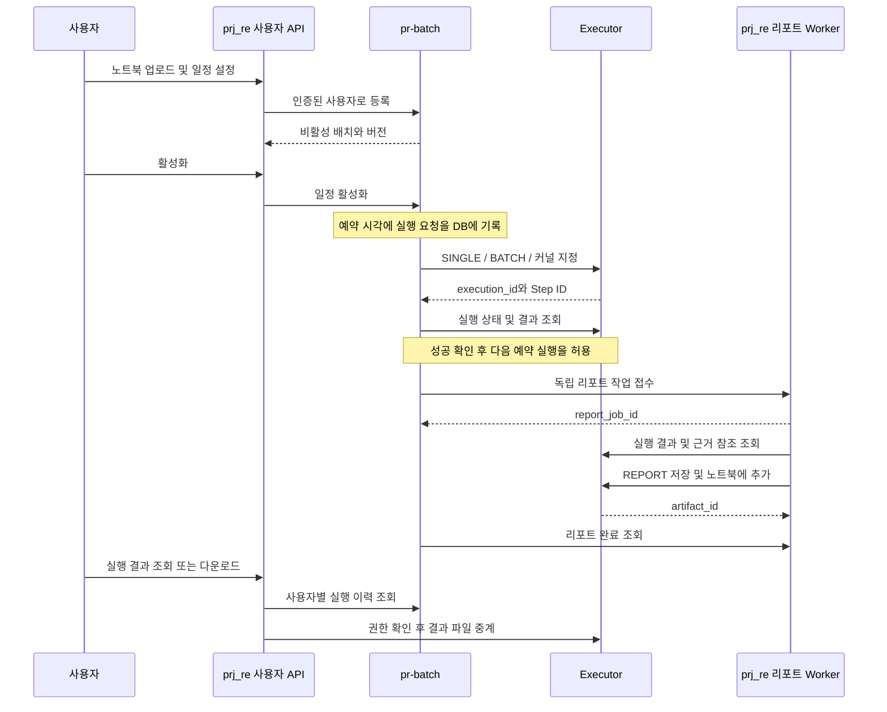

# 배치 서비스 설계 초안

`pr-batch`는 등록·일정·실행 흐름을 관리한다. Executor는 코드를 실행하고,
`prj_re`는 결과를 해석해 리포트를 만든다. PostgreSQL을 작업 상태의 기준으로
사용하고 초기에는 배치 서비스에 Redis 의존성을 추가하지 않는다.

상태: 검토용 초안. [확정 요구사항](requirements.md)을 구현하기 위한 제안이며,
아래 API·테이블·기본값은 아직 구현되거나 최종 승인된 계약이 아니다.
기술 스택은 Python 3.12, Ruff 줄 길이 79, ty를 유지한다.

## 서비스 책임

| 서비스 | 책임 |
| --- | --- |
| prj_re 사용자 API | 로그인·사용자 확인, 배치 API 전달, 결과 다운로드 중계 |
| pr-batch | 업로드·버전·일정 관리, 예약 접수, Executor 제출·상태 동기화, 리포트 요청 |
| Executor | 커널·BATCH 풀 배정, 코드 실행·재시도, 노트북·출력·산출물 저장 |
| prj_re 리포트 API | 실행 근거 수집·검증, 분석 보고서 생성, Executor Artifact 등록 |

각 서비스는 자기 테이블만 수정한다. 다른 서비스와의 연결은 API ID로 관리한다.
사용자용 프록시와 내부 리포트 API를 분리해 순환 호출이 생기지 않도록 한다.



## 등록과 버전

새 배치 등록은 새 `batch_id`와 v1을 만든다. 기존 배치의 새 버전 업로드는
같은 `batch_id` 아래 `version_id`와 단조 증가하는 `version_number`를 만든다.
파일명으로 수정본의 소속을 추정하지 않는다.

원본 SHA-256으로 바이트가 같은 업로드를 식별한다. 같은 배치에서 동일 원본을
다시 업로드하면 기존 버전을 반환하는 안을 제안한다. 실행 출력만 달라진 파일은
코드가 같을 수 있으므로 코드 셀의 순서·내용 해시도 별도로 기록하되, 서로 다른
원본을 자동 병합하지 않는다. 구버전 원본과 실행 연결은 변경하지 않는다.

업로드 시 JSON 및 nbformat, 코드 셀 여부, 실행할 내용의 존재, 크기·셀 수를
검증한다. 코드 이외의 셀이 있으면 조용히 버리지 않고 지원 범위를 안내하는
422를 반환하는 안이다. 빈 코드 셀은 실행 단계에서 제외하고 원본 인덱스 매핑을
보존한다. 과거 output·execution_count는 원본에 보관하되 새 실행 입력과 보고서
근거로 사용하지 않는다.

사용자는 `kernel_profile`을 명시한다. 노트북 메타데이터는 선택 안내에만 사용한다.
초기 실행 언어는 현재 Executor의 `PYTHON_EXECUTE` 계약에 맞춘 Python이다.
커널의 사내 라이브러리·자격증명·데이터 접근은 Executor 운영 환경에서 준비한다.
업로드 파일의 상대경로 데이터나 로컬 파일을 자동 복사하지 않는다.

일정은 `selected_version_id`를 고정한다. 새 버전 업로드와 일정에 적용하는 작업은
분리한다. 이미 접수된 실행의 버전·커널·코드·설정은 이후 수정에 영향받지 않는다.
예약 접수 시점의 설정을 저장하므로 대기 중인 실행도 원래 설정으로 수행한다.

## 저장소

배치 원본의 논리 경로 제안:

```text
batch-input/users/<opaque-owner-id>/batches/<batch-id>/
  versions/<version-id>/original.ipynb
  versions/<version-id>/cells/000000.py
  versions/<version-id>/cells/000001.py
```

실제 마운트 절대경로는 설정으로 관리한다. 사용자 입력 파일명과 사용자 ID를
그대로 경로에 삽입하지 않는다. 임시 파일 검증 후 같은 파일시스템에서 원자적으로
이동하고, 파일이 준비된 버전만 DB에서 공개한다. 중간 장애로 생긴 불일치는
재조정 작업으로 복구·격리하며 등록 원본을 자동 삭제하지 않는다.

Executor의 입력 루트에서 접근 가능한 상대경로와 SHA-256으로 셀을 제출한다.
배치 원본 PV, Executor 입력/결과 PV, Jupyter PV가 같은 저장소라고 가정하지
않는다. `prj_re`는 Executor 결과 루트를 읽고, Jupyter 산출물은 API로 접근한다.

## PostgreSQL 데이터 모델

독립 `batch` 스키마를 제안한다. 서비스 간 외래키나 다른 서비스 테이블 직접 조회는
사용하지 않는다. 시각은 `timestamptz`로 저장하고 사용자 표현에 시간대를 적용한다.

| 테이블 | 주요 필드와 제약 |
| --- | --- |
| batches | id, owner_id, name, lifecycle, revision, created_at, updated_at |
| notebook_versions | id, batch_id, version_number, original_path, sha256, code_hash, cell_map, created_at. 배치·버전번호 unique |
| schedule_revisions | id, batch_id, definition, timezone, version_id, kernel_profile, overlap_policy, misfire_policy, limits. 불변 설정 이력 |
| batch_schedules | batch_id unique, active_revision_id, enabled, next_fire_at, watermark, revision |
| batch_runs | id, batch_id, owner_id, schedule_revision_id, scheduled_for, trigger, version_id, kernel_profile, dispatch/execution/report 상태, executor_id, observed_version, terminal_result_ref |
| run_step_bindings | run_id, original_cell_index, sequence, executor_step_id, source_sha256 |
| report_requests | id, run_id, generation, job_id, evidence_identity, artifact_id, state, idempotency_key |
| delivery_commands | id, kind, target_id, immutable_payload, idempotency_key, state, lease_owner, lease_until, fence, next_attempt_at |
| idempotency_records | owner_id, operation, key, request_hash, resource_id. owner·operation·key unique |

예약 실행은 `(batch_id, schedule_revision_id, scheduled_for)`를 unique로 한다.
수동 실행은 사용자별 멱등성 키로 구분한다. 같은 키에 다른 내용은 409다.
조회 인덱스는 사용자·생성 시각, 미종료 실행·다음 조회 시각, 활성 일정·다음 예약
시각을 중심으로 둔다. 이력 목록은 cursor pagination을 사용한다.

원본 파일과 전체 출력은 DB에 복제하지 않는다. 실행 근거의 불변 manifest 참조,
Step별 Attempt/fence, 커널, 원본 버전과 해시를 기록해 보고서의 근거를 식별한다.
한 번의 복구 실행이 이전에 성공한 Step 결과를 재사용할 수 있으므로 최종 Attempt
ID 하나만으로 전체 근거를 표현하지 않는다.

## 일정 의미와 선택 옵션

초기에는 배치당 일정 하나를 제안한다. 여러 시각은 Cron 또는 요일·시각 목록으로
표현한다. 일정 등록·변경 응답에 다음 실행 예정 시각들을 반환해 사용자가 확인한다.

| 종류 | 제안하는 의미 |
| --- | --- |
| ONCE | 시간대가 명시된 미래 시각 1회 |
| INTERVAL | 기준 시각 + N초 간격. 종료 시각 기준 반복이 아닌 고정 간격 |
| CALENDAR | 매일, 지정 요일, 매월 지정일 또는 월말. 날짜가 없는 달은 건너뜀 |
| CRON | 분·시·일·월·요일의 5필드. 숫자, 범위, 목록, 간격 지원 |

Cron의 일과 요일은 둘 다 제한되면 OR 의미로 고정하는 제안이다. 초 단위 Cron,
`L/W/#` 같은 구현별 확장은 받지 않고 월말은 CALENDAR 옵션으로 표현한다.
최소 주기와 최대 미래 조회 범위는 운영 설정이다. 초기 제품 시간대는 Asia/Seoul로
제한하고 저장 형식은 IANA 이름을 사용해 향후 확장한다. 휴일 달력과 DST 정책은
다른 시간대·영업일 지원을 추가할 때 결정한다.

첫 활성화는 활성화 시각 이후부터 계산한다. 사용자가 의도적으로 중지한 기간은
장애로 놓친 일정에 포함하지 않는다. 재활성화는 미래 일정부터 시작한다.
예약된 시각을 이미 넘긴 ONCE의 활성화는 거절하고 수동 실행이나 새 시각을 안내한다.
`start_at` 포함, `end_at` 미포함으로 실행 기간을 정의한다.

실행 겹침 옵션:

- SKIP: 이미 코드 실행을 점유한 작업이 있으면 이번 실행을 SKIPPED로 기록.
- QUEUE: 예약 시각 순으로 대기. 이미 접수한 버전·커널을 유지.
- PARALLEL: 동일 배치의 동시 실행 한도 안에서 제출하고 초과분은 대기.

제안 기본값은 SKIP이며 등록 화면에서 선택값을 명시한다. 수동 실행도 같은 겹침
정책을 따른다. 대기 수가 한도에 도달하면 실행을 조용히 유실하지 않고
`SKIPPED_CAPACITY` 사유로 기록하며, 수동 요청은 409로 거절한다.

서비스 장애 등으로 발생한 misfire는 허용 지연시간을 넘긴 예약으로 판정한다.
SKIP, LATEST, CATCH_UP 중 선택하며 기본은 SKIP을 제안한다. CATCH_UP은
기간·횟수 상한 안에서 최신 N개를 고른 뒤 오래된 순서대로 접수한다.
생략한 구간·개수·사유는 범위 이력으로 남겨 장기 장애가 무한 행 생성으로
이어지지 않게 한다. 정상 시각의 예약은 이 복구 처리 후 접수한다.

고정 코드를 실행하므로 과거 예약을 보충해도 과거 데이터를 재현하는 것은 아니다.
코드가 현재 시각을 읽는다면 보충 실행에서도 현재 데이터를 읽는다. UI에서 이
의미를 알리고, 추후 파라미터 주입이 생기면 예약 시각 기준 조회 기간을 제공한다.

## 스케줄러와 장애 복구

API와 scheduler/dispatcher/reconciler를 논리적으로 분리한 FastAPI 기반 서비스를
제안한다. 단일 배포로 시작할 수 있으나 작업 상태는 메모리가 아닌 DB에 둔다.

1. 스케줄러가 짧은 트랜잭션에서 도래한 일정을 잠그고 실행과 제출 명령을 기록한다.
   일정 포인터 이동도 같은 트랜잭션에서 처리한다.
2. dispatcher는 `FOR UPDATE SKIP LOCKED`로 명령을 claim하고 lease/fence를 기록한다.
   배치 행 잠금 아래 점유량을 확인해 여러 worker의 동시 제출을 제한한다.
3. DB 트랜잭션 밖에서 Executor를 호출한다. 수신 여부가 불명확하면 동일 payload와
   동일 멱등성 키로 제출을 재확인한다. 새 실행으로 다시 제출하지 않는다.
4. lease 만료 후 다른 worker가 복구할 수 있다. 이전 worker의 쓰기는 fence로 막는다.
5. reconciler가 미종료 Execution을 제한된 동시성·backoff·jitter로 조회한다.
   API timeout을 실행 실패로 간주하지 않고 연결 상태와 마지막 관측 시각을 표시한다.
6. 성공 확인과 리포트 접수 명령 생성은 하나의 로컬 트랜잭션으로 처리한다.
   보고서 API의 응답 유실도 같은 접수 키로 복구한다.

초기에는 Redis 없이 조회 주기와 요청 한도로 호출량을 제어한다. Executor 내부
Redis와 Batch의 의존성은 별개다. 이후 이벤트 지연·조회량이 문제가 되면 목적을
명시하고 전용 consumer group·중복 제거·누락 복구를 갖춘 이벤트 연동을 검토한다.
DB와 네트워크 사이에서 전역 exactly-once를 주장하지 않는다. 중복 전달은 멱등성으로
흡수하며 노트북 자체의 외부 데이터 변경은 Executor 재시도 의미를 따른다.

## 실행과 리포트 상태

| 축 | 제안 상태 |
| --- | --- |
| dispatch | PENDING, WAITING_CAPACITY, SUBMITTING, SUBMITTED, FAILED, SKIPPED, CANCELLED |
| execution | NOT_SUBMITTED 및 Executor 원본 상태. retry/recovery 정보 별도 보존 |
| report | NOT_REQUESTED, PENDING, RUNNING, SUCCEEDED, FAILED, NOT_APPLICABLE |

전체 표시 상태는 위 축에서 계산한다. 실행 성공·리포트 실패는 REPORT_FAILED로,
둘 다 성공해야 COMPLETED로 표시한다. 미실행·실패·취소에는 보고서를 자동 생성하지
않는 안이다. 부분 결과는 다운로드 가능 여부를 별도로 제공한다.

코드 실행 구간의 보수적인 점유 범위는 제출 예약부터 Executor의 최종 terminal
확인까지로 제안한다. QUEUED, 통신 불명, 재시도 대기, FINALIZING도 점유에 포함한다.
코드 마지막 셀의 완료만 보고 점유를 해제하지 않는다. 리포트 구간은 점유에서 제외한다.
자동 재시도가 FAILED 뒤에도 이어질 수 있는지는 연동 미확정 사항이므로 그 계약을
확인하기 전 FAILED를 최종 실패로 판정하는 규칙은 구현하지 않는다.

비활성화는 미래 예약만 막는다. 이미 접수·대기·실행 중인 작업은 유지한다.
실행 취소는 별도 명령이다. 제출 전에는 로컬 취소, 제출 후에는 Executor 취소를
요청하고 실제 terminal을 확인한다. 접수 응답을 취소 완료로 표시하지 않는다.
노트북 성공 뒤에는 실행 취소로 보고서 작업을 취소하지 않으며, 별도 보고서 취소
기능은 초기 범위에 넣지 않는다.

## 내부 배치 API 제안

공개 경로는 `prj_re /api/v1/batches`, 내부 prefix는 `/internal/v1`을 제안한다.
아래 경로 앞에 내부 prefix를 붙인다. 기존 서비스에 이미 있는 API가 아니다.

| Method | 경로 | 동작 |
| --- | --- | --- |
| POST | /batches | multipart 파일·이름·커널·일정으로 비활성 등록. 201 |
| GET | /batches | 현재 사용자의 목록. cursor pagination |
| GET | /batches/{id} | 설정·선택 버전·다음 일정·최근 상태 |
| PATCH | /batches/{id} | 이름 등 일반 설정. revision 조건부 변경 |
| POST | /batches/{id}/versions | 원본 업로드. 새 버전 201, 동일 원본 200 |
| GET | /batches/{id}/versions | 버전 목록 |
| GET | /batches/{id}/versions/{version_id}/content | 소유권 확인 후 원본 다운로드 |
| PUT | /batches/{id}/schedule | 일정·버전·커널·정책의 새 revision |
| POST | /batches/{id}/enable | 설정 검증 후 활성화 |
| POST | /batches/{id}/disable | 미래 예약 중지 |
| POST | /batches/{id}/runs | 수동 실행 접수. 202 |
| GET | /batches/{id}/runs | 예약·수동·생략 이력 |
| GET | /batches/{id}/runs/{run_id} | 분리 상태·결과 링크·마지막 동기화 시각 |
| POST | /batches/{id}/runs/{run_id}/cancel | 취소 요청. 202 |
| POST | /batches/{id}/runs/{run_id}/report-retries | 리포트 단계만 재시도. 202 |

생성·명령에 `Idempotency-Key`, 설정 변경에 `If-Match` 또는 revision을 요구한다.
필수 정책은 요청에 명시하고 생략된 값을 묵시적으로 변경하지 않는다.
400은 잘못된 명령, 401/403은 인증·서비스 권한, 타 사용자 자원은 404,
409는 버전·상태·키 충돌, 413은 크기, 422는 노트북·일정 검증 오류다.
전체 실패 traceback이나 내부 마운트 경로는 사용자 응답에 넣지 않는다.

초기 삭제 API는 제안하지 않는다. 영구 보관 상태에서 화면 정리가 필요하면 향후
archive를 추가한다. 자동 삭제 없음과 중간 장애 임시 파일 정리 정책은 구분한다.

## 인증과 결과 URL

`prj_re`는 로그인·CSRF를 확인하고 업로드를 크기 제한과 함께 스트리밍 전달한다.
내부 API는 인증된 서비스가 전달한 사용자만 신뢰한다. 사용자 body나 외부의
`X-User-Id`만으로 소유자를 결정하지 않는다. mTLS 또는 서명된 단기 서비스 토큰 등
기존 인프라와 맞는 방식은 배포 계약에서 확정한다. 예약 실행은 브라우저 쿠키를
보관하거나 재사용하지 않는다.

결과 URL은 `prj_re`의 소유권 확인 경로로 반환하는 안이다. 예를 들어
`/api/v1/batches/{batch_id}/runs/{run_id}/notebook/content`에서 등록된 NOTEBOOK
artifact_id를 찾아 Executor `/api/v1/artifacts/{artifact_id}/content`를 중계한다.
리포트도 같은 방식으로 접근한다. 내부 Executor 주소·Jupyter 토큰을 노출하지 않는다.
인증된 Jupyter 화면 연결이 별도로 있으면 검증된 URL만 `open_url`로 제공한다.
파일 경로로 URL을 추측하지 않으며, 아직 생성되지 않은 결과의 URL은 null이다.

## 구현 순서와 검증 기준

1. 연동 미확정 사항 해결 및 API 계약 승인. 외부 서비스 변경 담당 범위 확정.
2. 사용자별 업로드·버전·일정 API와 PostgreSQL migration.
3. 일정 계산·중복 접수 방지·lease 복구·겹침 및 misfire 정책.
4. 실제 Executor BATCH 연동, 셀·Step 매핑, 상태·취소·결과 링크.
5. `prj_re` 독립 리포트 작업 API와 Executor Artifact 등록 연동.
6. 여러 worker와 장애 복구를 포함한 end-to-end 검증 후 운영 한도 결정.

필수 검증에는 같은 예약의 동시 claim, 제출 후 응답 유실, stale worker 쓰기,
일정 변경·새 버전과 대기 실행의 격리, 사용자 간 접근 차단, PV 경로 검증,
미스파이어 상한, 월말·Cron 의미, 커널 불일치, 취소 경합, 리포트 실패 후 코드
재실행 없음, Artifact 등록 응답 유실 후 중복 셀 없음이 포함된다.
IPython magic·shell 구문·마지막 표현식·상태 공유·표·이미지를 실제 커널로 확인한다.
처리량은 사용자 수로 추정하지 않고 대표 작업의 시간·출력 크기·동시성을 측정한다.
