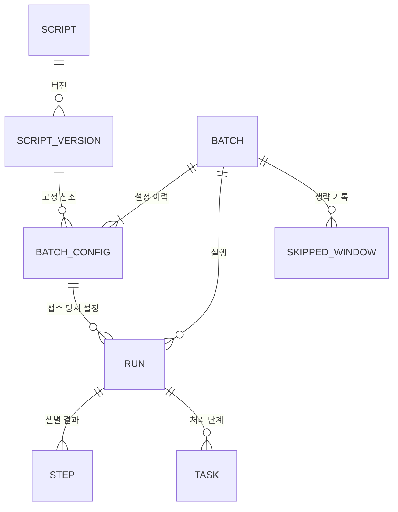

# pr-batch 서비스 체계 (도메인 모델)

상태: 구현됨. 코드 기준으로 정리한 현재 모델이다.

## 1. 한눈에 보기

```text
사용자 (owner, 호출 서비스가 X-User-Id로 보낸 ID, 소문자)
│
├── Script                         업로드한 스크립트 (여러 개, type: NOTEBOOK)
│   └── ScriptVersion              업로드 원본 1개 = 불변 버전 (v1, v2, …)
│       └── Cell                   실행 단위 목록. NOTEBOOK은 코드 셀만 실행 대상
│
└── Batch                          "이 스크립트 버전을 이 일정·정책으로 돌린다"는 등록
    ├── BatchConfig                실행 설정 이력 (버전·런타임·일정·정책의 불변 스냅샷 #1, #2, …)
    ├── SkippedWindow              실행하지 않고 넘긴 예약 구간 기록
    └── Run                        실행 1회 (예약 또는 수동)
        ├── Step                   셀 1개의 Executor 실행 결과 참조
        └── Task                   외부 호출 작업 큐 (내부 전용, 사용자에게 노출 안 함)
```

관계 요약:



- 모든 자원은 **사용자 소유**다. 프로젝트 개념은 없고(요건), 다른 사용자의 자원은 존재하지 않는 것처럼(404) 보인다.
- **Script와 Batch는 독립**이다. 스크립트 하나를 여러 배치가 쓸 수 있고, 배치는 스크립트의 특정 버전을 가리킨다.
- **불변 자원**: ScriptVersion, BatchConfig, Run의 스냅샷. 한 번 만들어지면 바뀌지 않아서, 과거 실행이 "무슨 코드를 어떤 설정으로 돌렸는지" 항상 재현 가능하다.
- **감사 필드**: 모든 자원 응답에 `created_at/by/by_type`, `updated_at/by/by_type`이 있다. 사람이 바꾸면 `USER`, 스케줄러·처리기가 바꾸면 `SYSTEM`([등록 API 안내](registration-api.md) 참고).
- **실행 이력 자동 삭제 없음**(요건). 끝난 내부 Task와 만료된 멱등성 기록만 보존 기간 뒤 지운다([아키텍처](architecture.md#41-보존-정리)). 사용자가 Script·Batch를 삭제하면 API에서 사라지지만(soft delete) 원본 파일·버전·설정·실행 이력은 DB와 PV에 남는다([등록 API 안내](registration-api.md#삭제)).

## 2. 자원별 설명

### Script

사용자가 올린 실행 코드 하나. 이름·타입과 버전 목록을 가진 "폴더" 같은 자원이다.

| 타입 | 실행 단위 | 상태 |
| --- | --- | --- |
| NOTEBOOK | `.ipynb`의 비어 있지 않은 코드 셀 하나 = Executor Step 하나 | 지원 |

타입은 등록 시 `type`으로 받아 고정한다. 새 버전은 스크립트의 타입으로 파싱하고,
타입별 파서가 파일을 실행 단위로 바꾼다. 새 타입은 파서만 추가하면 된다.

| 항목 | 내용 |
| --- | --- |
| 생성 | `POST /api/v1/scripts` (파일 업로드) → v1 자동 생성 |
| 주요 속성 | 이름, 최신 버전 번호, revision |
| 바뀌는 것 | 이름, 버전 추가 |
| API | `/api/v1/scripts`, `/api/v1/scripts/{script_id}` |

### ScriptVersion

업로드한 원본 파일 하나. 같은 스크립트에 수정본을 올리면 다음 번호의 버전이 된다.

| 항목 | 내용 |
| --- | --- |
| 생성 | 스크립트 생성 시 v1, 이후 `POST /scripts/{id}/versions` |
| 주요 속성 | 번호, 파일명(표시용), 원본 SHA-256, 코드 해시, 셀 목록 |
| 저장 | 원본 `.ipynb`와 실행용 셀 파일(`cells/000000.py` …)을 공유 PV에 저장 |
| 불변 | 바이트가 같은 파일을 다시 올리면 새 버전을 만들지 않고 기존 버전을 돌려줌 |
| API | `/scripts/{id}/versions`, `/versions/{version_id}`, `/versions/{version_id}/content` |

**Cell**은 별도 테이블이 아니라 버전 안의 목록이다. 셀마다 `index, type(code/markdown/raw), executed, sequence`를 가진다.
비어 있지 않은 코드 셀만 실행 대상이고, 실행 순서 번호(`sequence`)가 Executor의 Step 순서가 된다.

### Batch

"어떤 스크립트를, 언제, 어떻게 돌릴지"의 등록. 사용자가 관리하는 핵심 자원이다.

| 항목 | 내용 |
| --- | --- |
| 생성 | `POST /api/v1/batches` (JSON). 항상 **비활성**으로 생성 |
| 주요 속성 | 이름, 활성 여부, 다음 예약 시각, 현재 설정 번호, revision |
| 현재 설정 | 스크립트 버전, 런타임, 일정(선택), 정책 → 실제 값은 최신 BatchConfig에 있음 |
| 바뀌는 것 | 이름, 설정(PATCH), 활성/비활성(`disabled_reason`: `OWNER`·`USER_DEACTIVATED`). `tenant_id`·`project_id`는 등록 때 고정 |
| API | `/api/v1/batches`, `/batches/{batch_id}`, `/enable`, `/disable` |

수명주기:

```text
등록(비활성) ──enable──▶ 활성 ──disable──▶ 비활성 ──enable──▶ 활성 …
                        │
                        └─ 일정이 끝남(ONCE 완료, end_at 지남) → 활성이지만 next_run_at 없음
```

- 비활성이어도 **수동 실행은 가능**하다.
- 일정이 없는 배치는 수동 실행 전용이며 활성화할 수 없다.
- 비활성화는 앞으로의 예약만 막고, 이미 접수된 실행은 계속 진행된다.

### BatchConfig (실행 설정 이력)

배치의 실행 설정 스냅샷. 버전·런타임·일정·정책 중 하나라도 바뀌면 새 번호가 생긴다(이름 변경은 제외).

| 항목 | 내용 |
| --- | --- |
| 생성 | 배치 등록 시 #1, PATCH로 설정이 바뀔 때마다 #2, #3 … |
| 주요 속성 | 스크립트 버전, 런타임, 일정, 정책 |
| 왜 필요한가 | Run이 "접수 당시 설정"을 정확히 가리키게 하기 위해. 대기 중인 실행은 이후 설정을 바꿔도 원래 설정으로 돈다 |
| API | 별도 API 없음. 배치 응답의 `config_number`, 실행 응답의 `config_number`로 보임 |

일정(Schedule)과 정책(Policy)은 설정 안의 값이다.
- **Schedule**: ONCE / INTERVAL / CALENDAR / CRON, 시작·종료 기간, 시간대(Asia/Seoul)
- **Policy**: `overlap`(SKIP/QUEUE/PARALLEL/REPLACE, 모드별 `max_concurrent`·`max_queued`),
  `misfire`(SKIP/LATEST/CATCH_UP, 모드별 `grace_seconds`·`max_runs`·`max_age_seconds`)

### Run (실행)

배치의 실행 1회. 예약 시각이 되면 스케줄러가, 사용자가 누르면 API가 만든다.

| 항목 | 내용 |
| --- | --- |
| 생성 | 예약(`trigger=SCHEDULED`, `scheduled_for`) 또는 수동(`POST /batches/{id}/runs`, `trigger=MANUAL`) |
| 고정되는 것 | 접수 시점의 BatchConfig 번호, 스크립트 버전, 런타임, 일정·정책 사본, `tenant_id`, `project_id` |
| 외부 연결 | Executor `execution_id`, 결과 노트북 artifact |
| API | `/batches/{id}/runs`, `/runs/{run_id}`, `/runs/{run_id}/cancel` |

Run 상태:

| 상태 | 의미 | 다음 실행을 막는가 |
| --- | --- | --- |
| WAITING | 동시 실행 한도 때문에 대기 (QUEUE/PARALLEL/REPLACE) | 아니오 |
| SKIPPED | 겹침(`OVERLAP`)·대기열 초과(`SKIPPED_CAPACITY`)로 실행 안 함 | — |
| QUEUED | 자리 확보, Executor 제출 대기·진행 | 예 |
| RUNNING | Executor에서 코드 실행 중 | 예 |
| COLLECTING | 실행 종료, 셀별 결과·Artifact 수집 중 | 아니오 (요건: 겹침은 코드 실행 종료 기준) |
| COMPLETED | Executor SUCCEEDED, 결과 수집 완료 | — |
| FAILED | 코드 실행 실패, 제출 거절(`SUBMIT_REJECTED`), 원격 호출 포기(`ABANDONED`) | — |
| CANCELLED | 사용자 취소 또는 REPLACE 정책에 의한 취소 | — |

```text
WAITING ─▶ QUEUED ─▶ RUNNING ─▶ COLLECTING ─┬─▶ COMPLETED
   │          │          │                  ├─▶ FAILED
   ▼          ▼          ▼                  └─▶ CANCELLED
CANCELLED  CANCELLED·FAILED  FAILED(ABANDONED)
접수 시점: QUEUED · WAITING · SKIPPED
```

QUEUED 상태에서 취소하면 즉시 끝나지 않고 `cancel_requested`만 표시된다. 제출 Task가 Executor에
닿기 전이면 CANCELLED로 끝내고, 이미 제출됐거나 제출 여부가 불확실하면 Executor 실행을 취소한다.

### Step

Run 안에서 셀 1개의 실행 결과 참조. Executor의 Step과 1:1이다.

| 항목 | 내용 |
| --- | --- |
| 생성 | Run 접수 시 실행 대상 셀 수만큼 |
| 주요 속성 | 실행 순서, 원본 셀 인덱스, 셀 코드 해시, Executor step_id, 상태, 결과 참조(공유 PV 경로·해시) |
| 용도 | 실행 결과를 셀 단위로 추적 |
| API | `GET /runs/{run_id}` 응답의 `steps` |

### Task (내부 전용)

Run을 진행시키는 **외부 호출 1건**. 사용자 API에는 나오지 않는다.

| 종류 | 하는 일 |
| --- | --- |
| SUBMIT_EXECUTION | Executor에 실행 제출 |
| SYNC_EXECUTION | Executor 상태 조회 (적응형 간격) |
| COLLECT_RESULT | 셀별 결과·Artifact 수집 |
| CANCEL_EXECUTION | Executor 실행 취소 |

역할 분담:
- **Run 상태가 진실**이고 Task는 "그 상태가 되었으니 해야 할 외부 호출"이다.
- Run 상태를 바꾸는 트랜잭션에서 Task를 함께 만든다(트랜잭션 outbox). 그래서 둘이 어긋나지 않는다.
- Task는 실행 전에 Run 상태를 확인하고, 이미 지난 단계면 그냥 끝낸다.
- 원격 호출이 24시간(설정 가능) 계속 실패하면 Task를 끝내고 Run을 FAILED(`ABANDONED`)로 만든다.

모든 Pod가 같은 Task 큐를 나눠 처리한다. 한 Task는 한 Pod만 잡고(lease), Pod가 죽거나 스케일 인되면 다른 Pod가 이어받는다.

### SkippedWindow

실행하지 않고 넘긴 예약 구간. 장기 장애로 수천 건을 놓쳐도 행 하나에 "구간 + 건수"로 압축해 남긴다.

| 사유 | 언제 |
| --- | --- |
| MISFIRE_SKIP / MISFIRE_LATEST / MISFIRE_CATCH_UP | 서비스 장애 등으로 놓친 일정을 정책에 따라 생략 |
| DISABLED | 비활성화 시점에 아직 접수 못 한 과거 예약 |
| REPLACED_BY_LATEST | REPLACE 정책에서 한 번에 여러 일정이 도래했을 때 마지막 하나를 뺀 나머지 |
| SCHEDULE_REPLACED | 활성 중 일정을 바꿀 때 옛 일정의 미접수분 |
| DELETED | 활성 배치를 삭제할 때 아직 접수 못 한 과거 예약 |

API: `GET /batches/{id}/skipped-windows`

### 내부 보조 자원

| 자원 | 용도 |
| --- | --- |
| IdempotencyRecord | 같은 `Idempotency-Key`로 재전송된 쓰기 요청에 최초 응답을 그대로 돌려줌. 7일 뒤 삭제 |

## 3. 대표 흐름

### 매일 8시 정기 실행

1. 사용자가 `daily.ipynb`를 type NOTEBOOK으로 올림 → Script + v1.
2. 배치 등록: v1, 런타임 `JUPYTER/default`, CRON `0 8 * * *`, 겹침 SKIP → Batch(비활성) + BatchConfig #1.
3. 활성화 → `next_run_at = 다음 날 08:00`.
4. 08:00, 스케줄러가 Run(SCHEDULED, Config #1)과 SUBMIT_EXECUTION Task 생성.
5. Task 처리: 제출 → 상태 조회 → 결과 수집 → Run COMPLETED.
6. 사용자는 Run 상세에서 셀별 결과와 결과 노트북 artifact를 봄. 리포트는 pr-agentic-service가 Executor 이벤트로 만든다.

### 스크립트를 고쳐서 적용

1. 같은 스크립트에 수정본 업로드 → v2. 배치는 여전히 v1으로 돈다.
2. 배치 PATCH `{"script_version_number": 2}` → BatchConfig #2.
3. 이미 접수된 실행은 #1(v1)로, 이후 실행은 #2(v2)로 돈다.

## 4. API 경로 체계

```text
/api/v1/scripts
/api/v1/scripts/{script_id}
/api/v1/scripts/{script_id}/versions
/api/v1/scripts/{script_id}/versions/{version_id}
/api/v1/scripts/{script_id}/versions/{version_id}/content

/api/v1/batches                                   (?script_id= 필터)
/api/v1/batches/{batch_id}
/api/v1/batches/{batch_id}/enable | /disable
/api/v1/batches/{batch_id}/skipped-windows
/api/v1/batches/{batch_id}/runs
/api/v1/batches/{batch_id}/runs/{run_id}
/api/v1/batches/{batch_id}/runs/{run_id}/cancel
/api/v1/runtimes
```

결과 노트북 다운로드는 pr-batch가 중계하지 않는다. 실행 응답의 `result`에 있는 Executor artifact ID로
호출 서비스가 소유권 확인 후 Executor 다운로드 API를 호출한다.

목록의 `cursor`는 이전 응답의 `next_cursor`를 그대로 보내는 불투명 문자열이다.

Run은 항상 배치 아래에서 접근한다. 사용자 전체 실행 목록(`/api/v1/runs`)은 화면 요구가 생기면 추가한다.
