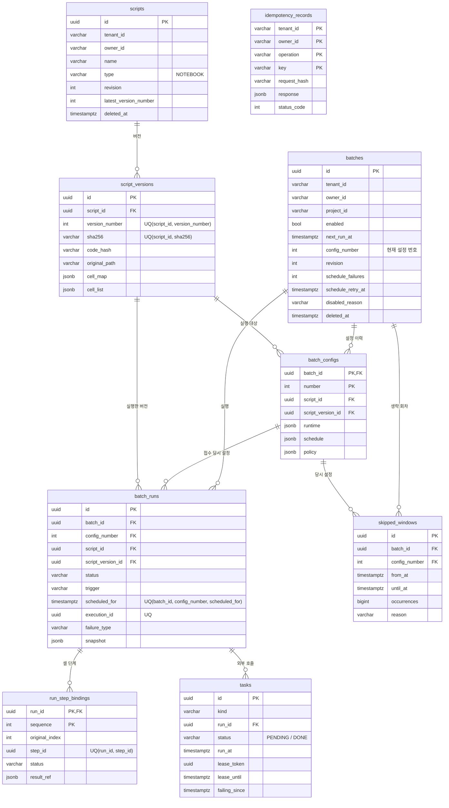

# pr-batch DB 물리 설계서 + ERD

기준: DB revision `0005_audit_client` (pr-batch `main`, 2026-11-13). 작성일 2026-11-22.
전체 DDL은 [03-db-schema.sql](03-db-schema.sql)에 있다(모델에서 생성, CI `alembic check`로 migration과 일치 확인).
엔터티의 의미와 업무 규칙은 [DB 논리 설계서](02-db-logical-design.md)를 본다.

---

## 1. 데이터베이스 개요

| 항목 | 값 |
| --- | --- |
| DBMS | PostgreSQL (CI는 16) |
| 드라이버 | `postgresql+psycopg` (psycopg 3)만 허용 |
| DB / 스키마 | DB `batch`, 스키마 `batch` (모든 테이블이 `batch.` 아래) |
| 앱 계정 | `batch`. 스키마 소유권(또는 USAGE·CREATE)만 있으면 됨. 스키마가 없으면 앱이 생성 |
| migration | Alembic, `migrations/versions/`. 앱 시작 시 advisory lock 아래 `upgrade head` (`DB_AUTO_MIGRATE`) |
| 버전 테이블 | `batch.alembic_version` (`version_num`) |
| 시간 | 모든 시각 컬럼은 `TIMESTAMP WITH TIME ZONE`. 업무 판단은 DB의 `clock_timestamp()` 기준 |
| 식별자 | UUID (앱에서 `uuid4` 생성). 서버 기본값 없음 |
| 기본값 | `schedule_failures`(`DEFAULT 0`)를 빼면 기본값은 모두 앱(ORM)에서 채운다. 수동 INSERT 시 NOT NULL 컬럼을 모두 직접 채워야 한다 |
| 커넥션 | 프로세스당 풀 2 + overflow 4 = 최대 6, `pool_pre_ping`, `pool_timeout` 10초, `connect_timeout` 5초 |

---

## 2. ERD



`idempotency_records`는 다른 테이블과 FK가 없는 독립 테이블이다.

---

## 3. 테이블 목록

| 테이블 | 설명 | 삭제 방식 | 증가 요인 |
| --- | --- | --- | --- |
| `scripts` | 업로드한 스크립트(노트북) | soft delete | 사용자 업로드 |
| `script_versions` | 스크립트 버전(불변) | 삭제 없음 | 업로드·새 버전 |
| `batches` | 배치(일정·정책의 주인) | soft delete | 사용자 등록 |
| `batch_configs` | 배치 실행 설정 이력(불변) | 삭제 없음 | 배치 생성·설정 변경 |
| `batch_runs` | 실행 이력 | **삭제 없음** | 예약·수동 실행마다 1행 |
| `run_step_bindings` | Run의 코드 셀 단계와 Executor step 연결 | **삭제 없음** | Run당 코드 셀 수(최대 100) |
| `skipped_windows` | 실행하지 않은 예약 회차(구간 압축) | 삭제 없음 | 생략 발생 시 |
| `tasks` | 내부 작업 큐 | `DONE` 후 30일 뒤 삭제 | Run당 3개 이상(SUBMIT 1, SYNC 1, COLLECT 1, 취소 시 CANCEL). SYNC는 같은 행을 재사용 |
| `idempotency_records` | 멱등 쓰기의 첫 응답 | 생성 후 7일 뒤 삭제 | 쓰기 요청마다 |

정리(retention)는 앱의 retention 루프가 한 시간마다 1000행씩 PK 기준으로 지운다.

---

## 4. 테이블 정의서

표기: PK 기본키, FK 외래키, UQ 유일, NN NOT NULL. 감사 컬럼(5절)은 표에서 생략한다.

### 4.1 `batch.scripts`

| 컬럼 | 타입 | NN | 설명 |
| --- | --- | --- | --- |
| `id` | uuid | PK | 스크립트 ID |
| `tenant_id` | varchar(64) | Y | 소유 tenant (생성 시 고정) |
| `owner_id` | varchar(255) | Y | 소유 사용자 (`X-User-Id`, 생성 시 고정) |
| `name` | varchar(255) | Y | 표시 이름 (변경 가능) |
| `type` | varchar(16) | Y | `NOTEBOOK`만 허용 (CHECK `script_type`) |
| `revision` | integer | Y | 낙관적 잠금 번호(≥1). `If-Match`와 비교 |
| `latest_version_number` | integer | Y | 마지막 버전 번호 |
| `deleted_at`, `deleted_by`, `deleted_by_client` | | | soft delete 정보 |

인덱스: `ix_scripts_owner_created (tenant_id, owner_id, created_at, id)` — 사용자별 목록(최신순, 커서 페이지).

### 4.2 `batch.script_versions`

| 컬럼 | 타입 | NN | 설명 |
| --- | --- | --- | --- |
| `id` | uuid | PK | 버전 ID |
| `script_id` | uuid | Y | FK → `scripts.id` |
| `version_number` | integer | Y | 스크립트 안 순번(≥1) |
| `filename` | varchar(255) | Y | 업로드 파일명 |
| `original_path` | varchar | Y | 공유 스토리지 상대경로(원본) |
| `sha256` | varchar(64) | Y | 원본 파일 해시. 다운로드 시 무결성 확인 |
| `code_hash` | varchar(64) | Y | 실행 코드만의 해시 |
| `size_bytes` | integer | Y | 원본 크기 |
| `cell_map` | jsonb | Y | 실행할 코드 셀 목록(순서, 원래 위치, 셀 파일 경로, 해시) |
| `cell_list` | jsonb | Y | 모든 원본 셀(종류, 실행 여부) |

제약: `uq_version_number (script_id, version_number)`, `uq_version_content (script_id, sha256)`(같은 내용 중복 업로드 금지), `uq_version_script_id (script_id, id)`(복합 FK 대상), CHECK `version_number_positive`.

### 4.3 `batch.batches`

| 컬럼 | 타입 | NN | 설명 |
| --- | --- | --- | --- |
| `id` | uuid | PK | 배치 ID |
| `tenant_id` | varchar(64) | Y | 소유 tenant. Executor 제출 tenant이기도 함 |
| `owner_id` | varchar(255) | Y | 소유 사용자 |
| `name` | varchar(255) | Y | 이름 |
| `enabled` | boolean | Y | 예약 활성 여부 |
| `next_run_at` | timestamptz | | 다음 예약 시각. 비활성이면 반드시 NULL |
| `revision` | integer | Y | 낙관적 잠금 번호 |
| `schedule_failures` | integer | Y | 현재 회차 예약 접수 실패 횟수 (DEFAULT 0, 0003) |
| `schedule_retry_at` | timestamptz | | 예약 접수 재시도 시각 (0003) |
| `config_number` | integer | Y | 현재 설정(`batch_configs.number`) |
| `project_id` | varchar(255) | | 등록 시 `X-Project-Id` (고정) |
| `client` | varchar(64) | | 등록한 API key의 client 이름 |
| `disabled_reason` | varchar(32) | | `OWNER`, `USER_DEACTIVATED`, `TENANT_REVOKED`(0004) |
| `disabled_at`, `disabled_by` | | | 비활성 시각·주체(client) |
| `deleted_at`, `deleted_by`, `deleted_by_client` | | | soft delete |

CHECK: `batch_revision_positive`, `disabled_has_no_next_run (enabled OR next_run_at IS NULL)`, `deleted_is_disabled`, `batch_disabled_reason`, `disabled_reason_is_disabled`.

인덱스:
- `ix_batches_due (enabled, next_run_at)` — 스케줄러가 1초마다 도래 배치를 찾는 쿼리 (`enabled AND next_run_at <= now ORDER BY next_run_at, id FOR UPDATE SKIP LOCKED LIMIT 1`).
- `ix_batches_owner_created (tenant_id, owner_id, created_at, id)` — 사용자별 목록.

### 4.4 `batch.batch_configs`

| 컬럼 | 타입 | NN | 설명 |
| --- | --- | --- | --- |
| `batch_id` | uuid | PK, FK → `batches.id` | |
| `number` | integer | PK | 배치 안 설정 순번(≥1) |
| `script_id`, `script_version_id` | uuid | Y | FK `fk_config_version_in_script` → `script_versions(script_id, id)` (그 스크립트의 버전임을 보장) |
| `runtime` | jsonb | Y | Executor 런타임 `{type, profile}` |
| `schedule` | jsonb | | 일정 (없으면 수동 전용) |
| `policy` | jsonb | Y | 겹침·놓친 일정 정책 |

인덱스: `ix_configs_script (script_id)` — 스크립트 삭제 가능 여부 검사.

### 4.5 `batch.batch_runs`

| 컬럼 | 타입 | NN | 설명 |
| --- | --- | --- | --- |
| `id` | uuid | PK | run_id |
| `batch_id` | uuid | Y | FK → `batches.id` |
| `config_number` | integer | Y | FK (`batch_id`, `config_number`) → `batch_configs` |
| `script_id`, `script_version_id` | uuid | Y | FK → `script_versions(script_id, id)` |
| `owner_id` | varchar(255) | Y | 배치 소유자(접수 시 복사) |
| `runtime` | jsonb | Y | 접수 시 런타임 |
| `snapshot` | jsonb | Y | 접수 시 고정값(스크립트·버전·해시, schedule, policy, tenant_id, project_id) |
| `trigger` | varchar(16) | Y | `SCHEDULED` / `MANUAL` |
| `scheduled_for` | timestamptz | | 예약 회차 시각 (수동은 NULL) |
| `status` | varchar(32) | Y | CHECK `run_status` (8개 값) |
| `skip_reason` | varchar(64) | | `OVERLAP`, `SKIPPED_CAPACITY`, `OWNER_DEACTIVATED`, `TENANT_REVOKED` (일괄 비활성 때 WAITING이던 Run) |
| `cancel_requested` | boolean | Y | 취소 요청 여부 |
| `cancel_source` | varchar(16) | | `USER` / `POLICY` |
| `cancel_reason` | varchar(255) | | Executor에 보낸 취소 사유 |
| `execution_id` | uuid | UQ | Executor 실행 ID |
| `operation_id` | uuid | | Executor operation ID |
| `execution_status` | varchar(32) | | Executor 원본 상태 |
| `observed_version` | integer | | 마지막으로 본 Executor 상태 버전 |
| `failure_type` | varchar(128) | | `SUBMIT_REJECTED`, `ABANDONED`, 또는 Executor `state.reason.code` |
| `notebook_status` | varchar(32) | | 결과 노트북 projection 상태 |
| `artifacts` | jsonb | Y | Executor artifact 목록 (기본 `[]`) |
| `attempts` | jsonb | Y | Executor 시도 목록 (기본 `[]`) |
| `retry_info` | jsonb | | Executor 재시도 정보 |
| `last_error` | varchar(64) | | 진행 중 마지막 통신·계약 오류 코드 |
| `submitted_at`, `observed_at` | timestamptz | | 제출, 마지막 관찰 (pr-batch 시계=DB) |
| `started_at`, `finished_at` | timestamptz | | Executor가 보고한 실행 시작·종료 |
| `completed_at` | timestamptz | | pr-batch에서 Run이 끝난 시각 |

제약: `uq_run_occurrence (batch_id, config_number, scheduled_for)` — 같은 설정의 같은 회차는 한 번만 접수(수동 실행은 `scheduled_for` NULL이라 제약 밖), `UNIQUE (execution_id)`, CHECK `run_status`, `run_cancel_source`.

인덱스:
- `ix_runs_batch_created (batch_id, created_at, id)` — 배치별 실행 목록(최신순 커서), WAITING 승격 순서.
- `ix_runs_batch_status (batch_id, status)` — 동시 실행 수 계산(접수·승격마다).
- `ix_runs_script_status (script_id, status)` — 스크립트 삭제 시 진행 중 Run 확인, 버전 FK (0002).

참고: `tenant_id` 컬럼은 없다. tenant는 `batches.tenant_id`와 `snapshot.tenant_id`로 안다.

### 4.6 `batch.run_step_bindings`

| 컬럼 | 타입 | NN | 설명 |
| --- | --- | --- | --- |
| `run_id` | uuid | PK, FK → `batch_runs.id` | |
| `sequence` | integer | PK | 실행 순서(0부터) |
| `original_index` | integer | Y | 원본 노트북의 셀 위치 |
| `source_sha256` | varchar(64) | Y | 셀 코드 해시 |
| `step_id` | uuid | | Executor step ID (제출 성공 후). UQ `(run_id, step_id)` |
| `status` | varchar(32) | | 셀 결과 상태 (수집 후) |
| `result_ref` | jsonb | | Executor 결과 참조 (수집 후) |

### 4.7 `batch.tasks`

| 컬럼 | 타입 | NN | 설명 |
| --- | --- | --- | --- |
| `id` | uuid | PK | |
| `kind` | varchar(32) | Y | `SUBMIT_EXECUTION`, `SYNC_EXECUTION`, `COLLECT_RESULT`, `CANCEL_EXECUTION` |
| `run_id` | uuid | | FK → `batch_runs.id` |
| `payload` | jsonb | Y | 부가 정보 (`interval`: 다음 조회 간격, `uncertain`, `abandoned`) |
| `status` | varchar(16) | Y | `PENDING` / `DONE` |
| `run_at` | timestamptz | Y | 실행 예정 시각 |
| `attempts` | integer | Y | 연속 시도 횟수 (성공 시 0) |
| `lease_token` | uuid | | 현재 처리 중인 worker의 토큰 |
| `lease_until` | timestamptz | | lease 만료 시각. 지나면 다른 인스턴스가 가져감 |
| `last_error` | varchar(64) | | 마지막 오류 코드 |
| `failing_since` | timestamptz | | 연속 실패 시작 시각 (포기 판단 기준) |
| `created_at` | timestamptz | Y | |

인덱스:
- `ix_tasks_due (run_at) WHERE status = 'PENDING'` — dispatcher claim (`status='PENDING' AND run_at <= now AND (lease_until IS NULL OR lease_until <= now) ORDER BY run_at, id FOR UPDATE SKIP LOCKED LIMIT 1`).
- `ix_tasks_run (run_id)` — Run별 Task 조회, FK.
- `ix_tasks_done_created (created_at) WHERE status = 'DONE'` — retention 삭제.

### 4.8 `batch.skipped_windows`

| 컬럼 | 타입 | NN | 설명 |
| --- | --- | --- | --- |
| `id` | uuid | PK | |
| `batch_id` | uuid | Y | FK → `batches.id` |
| `config_number` | integer | Y | FK (`batch_id`, `config_number`) → `batch_configs` |
| `from_at`, `until_at` | timestamptz | Y | 생략 구간 (CHECK `from_at < until_at`) |
| `occurrences` | bigint | Y | 구간 안 생략 회차 수 (>0) |
| `reason` | varchar(64) | Y | `MISFIRE_SKIP`, `MISFIRE_LATEST`, `MISFIRE_CATCH_UP`, `REPLACED_BY_LATEST`, `SCHEDULER_ERROR`, `DISABLED`, `SCHEDULE_REPLACED`, `DELETED`, `OWNER_DEACTIVATED`, `TENANT_REVOKED` (값 의미는 논리 설계서 5장) |

인덱스: `ix_skipped_batch_created (batch_id, created_at, id)`.

### 4.9 `batch.idempotency_records`

| 컬럼 | 타입 | NN | 설명 |
| --- | --- | --- | --- |
| `tenant_id`, `owner_id`, `operation`, `key` | varchar | PK | 범위: 같은 key라도 tenant·사용자·작업이 다르면 별개 |
| `request_hash` | varchar(64) | Y | 요청 본문 지문. 같은 key 다른 본문이면 409 |
| `response` | jsonb | | 첫 응답 본문 |
| `status_code` | integer | | 첫 응답 상태 코드 |
| `created_at` | timestamptz | Y | |

인덱스: `ix_idempotency_created (created_at)` — retention 삭제.

---

## 5. 공통 감사 컬럼

`scripts`, `script_versions`, `batches`, `batch_configs`, `batch_runs`, `skipped_windows`에 있다.

| 컬럼 | 타입 | NN | 설명 |
| --- | --- | --- | --- |
| `created_at`, `updated_at` | timestamptz | Y | |
| `created_by`, `updated_by` | varchar(255) | | 사용자(`X-User-Id`). 백그라운드 작업(스케줄러·dispatcher)은 NULL |
| `created_by_client`, `updated_by_client` | varchar(64) | | 호출 API key의 client 이름. 백그라운드는 NULL |
| `deleted_by`, `deleted_by_client` | | | soft delete 테이블(`scripts`, `batches`)만 |

`updated_*`는 레코드 내용이 바뀔 때만 갱신한다. 스케줄러가 `next_run_at`을 옮기는 것은 갱신으로 치지 않는다.
0005 이전에는 `*_by_type` 컬럼이 있었다(삭제됨).

---

## 6. 잠금과 동시성

| 대상 | 방식 | 목적 |
| --- | --- | --- |
| 예약 접수 | `batches` 행 `FOR UPDATE SKIP LOCKED` | 여러 인스턴스가 같은 회차를 두 번 접수하지 않음 |
| Task claim | `tasks` 행 `FOR UPDATE SKIP LOCKED` + `lease_token`·`lease_until` | 정확히 한 worker가 처리. 늦게 끝난 옛 worker의 반영은 토큰 불일치로 차단 |
| Run 반영 | `batches` 행 → `batch_runs` 행 순서로 `FOR UPDATE` | 접수·승격·완료가 같은 배치에서 직렬화. 교착 방지를 위해 순서 고정 |
| 수정 API | `revision` + `If-Match` | 낙관적 잠금 |
| migration | PostgreSQL advisory lock | 한 인스턴스만 migration |

원격 호출(Executor) 중에는 트랜잭션·커넥션을 잡지 않는다. "짧은 claim 트랜잭션 → 반납 → 원격 호출 → 짧은 반영 트랜잭션"이다.

---

## 7. 용량 추정

| 테이블 | 행 크기 감각 | 증가 공식 |
| --- | --- | --- |
| `batch_runs` | 1~수 KB (jsonb `snapshot`, `artifacts`, `attempts` 포함) | 하루 실행 수 |
| `run_step_bindings` | 수백 B | 하루 실행 수 × 노트북 코드 셀 수 |
| `tasks` | 수백 B | 하루 실행 수 × 3~4, 30일 보존 |
| `idempotency_records` | 응답 본문 크기 | 하루 쓰기 요청 수, 7일 보존 |
| `script_versions` | `cell_map`·`cell_list` 크기(셀 수 비례) | 업로드 수 |

예: 배치 500개가 하루 1회, 평균 코드 셀 30개면 `batch_runs` 하루 500행·연 18만 행, `run_step_bindings` 하루 1.5만 행·연 550만 행이다. 이 규모까지는 현재 인덱스로 충분하지만, **실행 이력 보존 기간(자동 삭제 없음)은 운영 1년 시점에 다시 논의**할 것을 권한다.

---

## 8. 백업·복구 (권장안)

DB는 내부 SaaS PostgreSQL이고 전담 DBA가 없다. 아래는 이 서비스의 데이터 특성에서 도출한 권장안이며, SaaS가 제공하는 백업 기능에 맞춰 값을 확정한다.

### 8.1 무엇을 지켜야 하나

| 데이터 | 유실 시 | 중요도 |
| --- | --- | --- |
| `scripts`, `script_versions`, `batches`, `batch_configs` | 사용자가 다시 올리고 등록해야 함. 재생성 불가 | 높음 |
| `batch_runs`, `run_step_bindings`, `skipped_windows` | 실행 이력 소실(요건상 영구 보존 대상) | 높음 |
| 공유 스토리지 `batch/inputs/` | 노트북 원본·셀 파일 소실. 해당 버전은 실행·다운로드 불가 | 높음 (DB와 한 쌍) |
| `tasks` | 진행 중이던 Run이 멈춤. 끝난 Task는 영향 없음 | 중간 |
| `idempotency_records` | 최근 7일 안의 재전송이 새 요청으로 처리될 수 있음 | 낮음 |

### 8.2 권장 설정

| 항목 | 권장 | 이유 |
| --- | --- | --- |
| 백업 범위 | DB `batch` 전체 (스키마 `batch`, `alembic_version` 포함) | 테이블끼리 FK로 묶여 있어 일부만 복원할 수 없음 |
| 주기 | 전체 백업 하루 1회(새벽, 예약 실행이 적은 시간). 가능하면 시점 복구(PITR) 사용 | 일 단위 배치가 많아 하루치 유실까지가 현실적인 한계. PITR이 있으면 유실을 분 단위로 줄임 |
| 보존 기간 | 최소 14일, 권장 30일 | 데이터 오류를 뒤늦게 발견해도 되돌릴 수 있게 |
| 공유 스토리지 | DB 백업과 같은 주기로 스냅샷 | DB의 경로·해시와 파일이 맞아야 함. 파일은 추가만 되고 수정·삭제가 없어 증분 백업에 적합 |
| 복구 리허설 | 반기 1회, dev에 복원해 8.3 절차 수행 | 백업이 실제로 복원되는지는 해 봐야 안다 |
| 목표 | 유실 허용(RPO) 24시간 이내, 복구 시간(RTO) 4시간 이내 | 내부 부가 서비스 수준. 요건이 더 엄격하면 PITR 필수 |

### 8.3 복구 절차

1. **백그라운드를 끄고 띄운다.** `BACKGROUND_ENABLED=false`로 배포해 예약·Task 처리가 복원 직후 바로 돌지 않게 한다. (API를 막아야 하면 서비스를 내린다.)
2. **DB를 복원한다.** 복원 후 `SELECT version_num FROM batch.alembic_version;`이 배포된 코드의 revision(현재 `0005_audit_client`)과 같거나 그 이전인지 확인한다. 이전이면 앱이 시작할 때 자동 migration한다.
3. **스토리지와 맞는지 확인한다.** 아래 SQL로 최근 버전의 원본 경로를 뽑아 파일이 있는지 본다. 스토리지가 DB보다 과거면 그 사이 올린 버전은 다운로드가 `STORAGE_INTEGRITY_ERROR`, 실행은 실패한다.
   ```sql
   SELECT id, script_id, original_path, created_at
   FROM batch.script_versions ORDER BY created_at DESC LIMIT 50;
   ```
4. **진행 중이던 Run을 점검한다.**
   ```sql
   SELECT id, batch_id, status, execution_id, updated_at
   FROM batch.batch_runs WHERE status IN ('WAITING','QUEUED','RUNNING','COLLECTING');
   ```
   - `QUEUED`: 재개하면 같은 멱등성 키로 다시 제출한다. Executor에 이미 실행이 있으면 그 실행에 붙으므로 중복 실행은 없다.
   - `RUNNING`, `COLLECTING`: 재개하면 Executor 상태를 조회해 따라잡는다. 이미 끝났으면 바로 결과를 수집한다.
   - 백업 시점 이후에 만들어진 Run은 DB에 없다. Executor에는 그 실행이 남아 있을 수 있으나 pr-batch는 모른다(이력 유실).
5. **보충 실행을 예상한다.** 복원된 `next_run_at`이 과거이므로, 재개하면 배치별 misfire 정책대로 처리된다. `CATCH_UP` 배치는 놓친 회차를 한꺼번에 실행한다. 몰림이 걱정되면 재개 전에 해당 배치를 확인한다.
   ```sql
   SELECT b.id, b.name, b.next_run_at, c.policy->'misfire' AS misfire
   FROM batch.batches b
   JOIN batch.batch_configs c ON c.batch_id = b.id AND c.number = b.config_number
   WHERE b.enabled AND b.next_run_at < now();
   ```
6. **백그라운드를 다시 켠다.** `BACKGROUND_ENABLED`를 원래대로 배포하고, 운영자 가이드 5.5의 1)·2) SQL로 멈춘 Run이 없는지 확인한다.

---

## 9. migration 이력

| revision | 내용 |
| --- | --- |
| `0001_initial` | 전체 테이블·제약·인덱스 (운영 전 하나로 합침. 고치지 않음) |
| `0002` | `ix_runs_script_status` 추가 |
| `0003` | `batches.schedule_failures`, `schedule_retry_at` 추가 (예약 접수 재시도) |
| `0004` | `disabled_reason`에 `TENANT_REVOKED` 허용 |
| `0005_audit_client` | 감사 컬럼 `*_by_type` 삭제, `*_by_client` 추가, `*_by` nullable. 이전 버전과 동시 실행 불가였음 |
