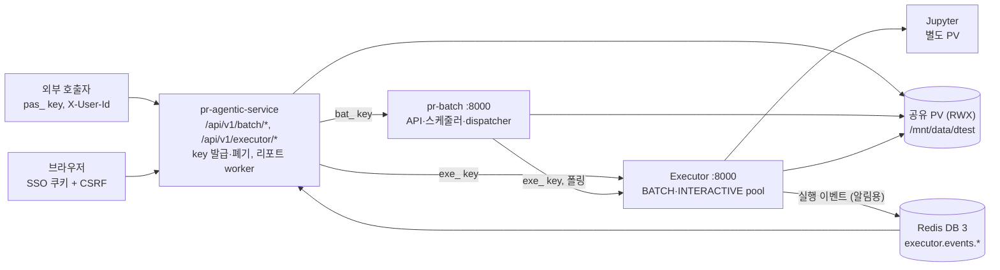

# 통합테스트 시나리오: 에이전트 → pr-batch → Executor

작성일 2026-11-01

## 요약

시나리오 52개를 6개 그룹으로 나눠 로컬에서 먼저 돌리고, 같은 시나리오를 dev 클러스터에서 다시 확인하는 방안을 제안합니다. 이전 점검에서 미검증으로 남은 게이트웨이 경유 호출(그룹 B·C), 실행 취소(그룹 D), 실제 클러스터·PVC·key(그룹 A)는 모두 P0로 넣었습니다.

기준 커밋은 pr-batch `06a3d9a`, executor `170ad98`, pr-agentic-service `f5281e1`입니다. 코드는 읽기만 했고 이 시나리오를 실제로 돌리지는 않았습니다.

세 레포를 대조하니 테스트 전에 고칠 설정 불일치가 나왔습니다.

- **PVC 이름:** pr-batch만 `executor-shared`이고 나머지 둘은 `executor-shared-pvc`입니다.
- **Redis DB:** executor는 DB 3, 에이전트 설정 틀은 DB 0입니다. 그대로 두면 이벤트가 오지 않고, 10분마다 도는 복구가 이를 가려서 겉으로는 리포트가 늦게 만들어질 뿐입니다.
- **pr-batch 주소:** 에이전트 설정 틀은 포트 8100인데 클러스터 Service는 8000입니다.

알려 주신 내용 중 `SERVICE_KEYS_ENABLED`를 true로 바꿔야 한다는 항목은 지금 코드와 다릅니다. 에이전트 main에서 이 설정이 삭제되어 값을 넣어도 무시되므로, 할 일은 `f5281e1` 이후 이미지를 배포하는 것뿐입니다. `DOCS_ENABLED`도 pr-batch와 에이전트는 dev에서 false지만 executor는 dev에서 true입니다.

시작 전 결정 사항은 아래와 같고, SSO 계정 전달만 남았습니다. 자세한 근거는 마지막 절에 있습니다.

- [ ] 비활성화 테스트에 쓸 SSO 계정 1개: 내부망 반입 후 전달받기로 함 (실제 사용자 비활성화가 일어납니다).
- [ ] 배치 실행 제어 경로: 에이전트 → pr-batch → Executor만 허용한다. 게이트웨이의 직접 제출·취소·재시도는 막으며, 결과 조회는 Executor 게이트웨이를 유지한다. 시험 전 수정 내용은 [에이전트 게이트웨이 변경 전달 문서](agent-gateway-batch-control.md)에 있다 (결정).
- [ ] pr-batch DB 연결 한도: 12를 유지해 F2를 시험하고, 오류가 나면 18로 올린다 (결정).

## 연동 구조와 호출 계약

시험의 핵심은 경계가 세 곳이라는 점입니다. 호출자와 에이전트 사이, 에이전트와 하위 서비스 사이, pr-batch와 Executor 사이에서 각각 인증과 tenant가 새로 정해집니다.

pr-batch는 실행 상태를 폴링으로 확인하고 이벤트를 쓰지 않습니다. 이벤트는 에이전트 리포트 worker만 쓰므로, Redis가 어긋나면 실행은 정상이고 리포트만 늦어집니다.

| 구간 | key | 신원 헤더 | 시험할 응답 |
| --- | --- | --- | --- |
| 호출자 → 에이전트 | `pas_` (DB 해시, 폐기 반영 최대 60초) | `X-User-Id` 필수. 자기 tenant key는 우리 활성 사용자만, 외부 tenant key는 형식만 | 401 key 오류, 400 `INVALID_IDENTITY`, 403 미등록·비활성 |
| 에이전트 → pr-batch | `bat_` (relay, admin) | 모든 호출에 `X-Tenant-Id`, 등록 때만 `X-Project-Id`. `GET /runtimes`는 key만 | 404 다른 tenant·사용자, 422 본문 `tenant_id`, 403 허용 밖 tenant |
| 에이전트 → Executor | `exe_` (relay) | `X-Tenant-Id` 항상, `X-User-Id` 없는 GET은 tenant 전체 조회 | 404 다른 tenant, 400 쓰기에 사용자 없음, 502·504 연결 실패 |
| pr-batch → Executor | `exe_` (relay, 기본 tenant 없음) | owner와 snapshot의 tenant·project | 400·401·403·422는 `FAILED`(`SUBMIT_REJECTED`), 통신 오류는 24시간 재시도 |
| 운영자 → Executor | `exe_` (ops, admin) | 없음 | `/workerz` 200, 다른 key 403, 모르는 key 401 |

오류 본문 형식은 서비스마다 다릅니다. pr-batch의 `{code, message, errors}`를 에이전트 게이트웨이가 `{error: {code, message, details}}`로 바꿔 돌려주므로, 시나리오는 게이트웨이 응답의 `error.code`로 판정합니다.

## 사전 준비

설정 파일이 이미지에 들어가므로, key를 바꾸면 서비스를 다시 빌드해야 합니다. 아래 값을 한번에 맞춘 뒤 빌드하는 것이 가장 빠릅니다.

### dev 클러스터 설정

| 항목 | 설정 위치 | 맞출 값 |
| --- | --- | --- |
| 공유 PVC | pr-batch `deploy/k8s/deployment.yaml:99`, executor `deploy/kubernetes/deployment.yaml:106`, 에이전트 `deploy/kubernetes/deployment.yml:46` | 실제 RWX claim 하나로 통일, `/mnt/data`에 마운트 |
| 저장 경로 | 각 `config.dev.yml`, 에이전트 `config.yml` | pr-batch `STORAGE_ROOT=/mnt/data/dtest`, Executor `INPUT_STORAGE_ROOT=/mnt/data/dtest`, `SHARED_STORAGE_ROOT=/mnt/data/dtest/executor`, 에이전트 `STORAGE_ROOT=/mnt/data/dtest/dtest-agent-service`, `EXECUTOR_RESULT_ROOT=/mnt/data/dtest/executor` |
| Executor key 3개 | `python3 scripts/generate_api_keys.py dev` (executor) | 해시는 executor `AUTH_CLIENTS`, 원문은 에이전트 `EXECUTOR_API_KEY`·`EXECUTOR_ADMIN_API_KEY`, pr-batch `EXECUTOR_API_KEY` |
| pr-batch key | `docs/client-auth.md`의 생성 명령 | 해시는 pr-batch `AUTH_CLIENTS`(`relay`, `allowed_tenants: ["*"]`, `admin`), 원문은 에이전트 `BATCH_API_KEY` |
| 서비스 주소 | 에이전트·pr-batch `config.dev.yml` | `BATCH_BASE_URL=http://pr-batch:8000`, `EXECUTOR_BASE_URL=http://executor:8000` (`/api/v1` 없이) |
| Redis | 에이전트 `config.dev.yml`, executor `config.dev.yml` | 같은 호스트와 같은 DB 번호. executor 기본은 DB 3 |
| 관리자 | 에이전트 `ADMIN_EMPLOYEE_IDS` | 관리자의 **첫 로그인 전에** 채움. 첫 로그인 때만 권한이 부여됨 |
| 환경 이름 | Deployment의 `APP_ENV`, 이미지 빌드 인자 | executor·에이전트 매니페스트 기본이 `prd`이므로 `dev`로 변경. executor 이미지와 값이 같아야 함 |
| DB | PostgreSQL | pr-batch 역할 `CONNECTION LIMIT 12`와 DB `batch`. 세 서비스 DB와 PV 초기화 |
| Runtime target | 배포 후 ops key로 `POST /api/v1/runtime-targets` | BATCH·INTERACTIVE pool 등록. `RUNTIME_CREDENTIAL_KEY`는 고정 |

### 시험 데이터

| 종류 | 값 | 쓰임 |
| --- | --- | --- |
| 자기 tenant key | `dtest-agent-service`, `own_tenant: true` | SSO 사용자와 같은 공간 |
| 외부 tenant key | `itest-a`, `itest-b` (예시) | 격리 시험, `itest-b`는 E2에서 폐기 |
| 사용자 | SSO 계정 A·B, 비활성화용 C. 외부 tenant는 `svc-itest-1` 추가 | SSO 계정은 한 번 로그인해야 자기 tenant key로 부를 수 있음 |
| 노트북 | 짧은 성공, 10분 이상 실행(PV에 시각 기록), 예외 발생, 빈 노트북, 10 MiB 초과 | C·D·F |
| 배치 이름 | `itest-` 접두어 | 종료 후 정리 |

### 로컬 구성

executor의 `shared-infra`, `executor-runtimes`, `executor`를 올리고, pr-batch와 에이전트 compose를 붙입니다. 두 가지는 미리 해야 합니다.

- **pr-batch의 Executor key:** `compose.yaml`에 `EXECUTOR_API_KEY`가 없고 `.env`는 이미지에 들어가지 않습니다. 그대로 두면 모든 실행이 401로 거절되니, executor `docker-compose.yml` 주석의 로컬 key를 compose override로 넣습니다.
- **등록과 key:** BATCH target은 자동 등록되지 않으므로 `docs/runtime-targets.md` 순서대로 등록합니다. 에이전트 `.env`에는 `BATCH_API_KEY`를 넣습니다.

로컬에서는 `SSO_ADAPTER=dev`로 로그인하고, 리포트는 compose의 `mock` 프로필 LLM으로 확인합니다.

## 시나리오 목록

P0이 하나라도 실패하면 연동 완료로 보지 않습니다. 별도 표시가 없으면 호출은 에이전트 게이트웨이 `/api/v1/batch/*`와 `/api/v1/executor/*`를 거칩니다. "로컬"이 비어 있는 행은 클러스터에서만 확인할 수 있습니다.

### A. 배포와 연결 (실제 클러스터·PVC·key)

| ID | 우선 | 로컬 | 확인할 일 | 기대 결과 |
| --- | --- | --- | --- | --- |
| A1 | P0 | O | 세 서비스의 이미지 커밋과 `/healthz`·`/readyz` | 기준 커밋 이후, 모두 200 |
| A2 | P0 |  | 세 파드의 `claimName`이 같고 서로의 파일이 보이는가. pr-batch가 `/mnt/data/dtest/batch/inputs/`에 쓴 표식 파일을 Executor에서 읽고, Executor 결과 폴더를 에이전트에서 읽는다 | 같은 PVC, 표식 파일의 해시 일치, 쓰기 권한 오류 없음 |
| A3 | P0 | O | key 행렬. 각 key로 `GET /api/v1/batch/runtimes`, Executor `/workerz`를 부른다 | ops key만 `/workerz` 200, 다른 key 403, 모르는 key 401, 게이트웨이 200 |
| A4 | P0 | O | ops key로 `GET /runtime-targets` | BATCH·INTERACTIVE pool에 ACTIVE target, `default`·`3102311` kernel이 `/runtimes` 목록과 일치 |
| A5 | P0 | O | 처음 수동 실행 이후 `executor.events.dtest-agent-service` 스트림이 에이전트의 Redis DB에 보이는가 | Executor와 같은 DB, 리포트 작업이 1분 안에 시작 |
| A6 | P1 | O | 각 서비스 `/docs` | dev에서 pr-batch·에이전트 404, Executor 200. stg·prd 설정은 모두 false |
| A7 | P1 |  | pr-batch `EXECUTOR_API_KEY`만 잘못된 값으로 덮어 수동 실행 | `FAILED`, `SUBMIT_REJECTED`, `last_error=EXECUTOR_HTTP_401:…`, ERROR 로그. 원복 후 정상 |

### B. 게이트웨이 인증과 tenant 격리

| ID | 우선 | 로컬 | 확인할 일 | 기대 결과 |
| --- | --- | --- | --- | --- |
| B1 | P0 | O | key 없음, 모르는 key, pr-batch에 `pas_` key를 직접 전송 | 모두 401 |
| B2 | P0 | O | `X-User-Id` 없음·형식 오류, `X-Project-Id: unscoped` | 400 `INVALID_IDENTITY` |
| B3 | P0 | O | `E12345`와 `e12345`로 각각 호출 | 같은 사용자의 같은 자원이 보인다 |
| B4 | P0 | O | 자기 tenant key에 미등록 사번, 외부 tenant key에 미등록 사번 | 전자 403, 후자는 통과 |
| B5 | P0 | O | 호출자가 `X-Tenant-Id`를 다른 값으로 보내고 자원을 만든다 | 무시되고 key의 tenant로 생성. 감사 로그 `tenant=`가 key의 tenant |
| B6 | P0 | O | tenant A의 배치·실행·artifact를 tenant B key로, 같은 tenant의 다른 사번으로 조회·변경한다. 같은 사번이 다른 tenant에서 부르는 경우도 포함 | 모두 404, 목록에 나타나지 않음 |
| B7 | P0 | O | `batches:disable-by-owner`, `batches:disable-by-tenant`, `/runtime-targets`, `/maintenance`, `/diagnostics`를 key 호출자로 부른다 | 모두 게이트웨이 404 |
| B8 | P1 | O | 본문에 `tenant_id`·`context` | pr-batch 422 `VALIDATION_ERROR`, Executor 422 |
| B9 | P1 | O | 쿠키와 key를 함께 보내기, 쿠키 쓰기에 CSRF 빼기, 쿠키로 `POST /executor/executions` | 쿠키로 판정, CSRF 거부, 쓰기는 404(코드 기준) |
| B10 | P1 | O | 자기 tenant에서 멤버가 아닌 `X-Project-Id`로 등록, 외부 tenant에서 임의 값으로 등록 | 전자 404, 후자는 저장되고 이후 변경 불가 |

### C. 배치 수명주기

| ID | 우선 | 로컬 | 확인할 일 | 기대 결과 |
| --- | --- | --- | --- | --- |
| C1 | P0 | O | 노트북 업로드·새 버전·동일 파일 재업로드, 같은 `Idempotency-Key` 재전송 | 201, 동일 바이트는 200, 재전송은 같은 응답. `ETag`와 `Location` 전달 |
| C2 | P0 | O | 일정 없는 배치와 있는 배치 등록, enable·disable | `enabled=false`. 일정 없음: `can_enable=false`, `enable_blocked_reason=SCHEDULE_REQUIRED`, enable 409. 일정 있음: `can_enable=true`, enable 후 `can_disable=true` |
| C3 | P0 | O | 수동 실행을 끝까지 추적 | `QUEUED → RUNNING → COLLECTING → COMPLETED`. `execution_id`와 `notebook_artifact_id`가 채워짐 |
| C4 | P0 | O | 게이트웨이로 Execution 조회, 결과 노트북 다운로드 | `trigger.type=BATCH`, actor와 `context.user_id`가 사번, `metadata.run_id` 일치, tenant 일치, 셀 실행 결과 포함 |
| C5 | P0 |  | 자기 tenant 배치의 리포트. 외부 tenant 배치는 리포트 없음 (LLM 필요, 로컬은 mock 가능) | 자기 tenant: 작업 시작 1분 이내, 1건만. 외부 tenant: 0건 |
| C6 | P0 | O | `ONCE`로 3분 뒤 예약(`Asia/Seoul`) 후 enable, 다른 배치는 disable | 예약 실행 1회, `trigger=SCHEDULED`, `scheduled_for` 일치. disable한 배치는 실행 없음 |
| C7 | P0 | O | 예외를 던지는 노트북 | `FAILED`, `failure_type` 채워짐, 리포트 없음, 다음 실행 가능 |
| C8 | P1 | O | 오래된 `ETag`로 PATCH, 새 버전 올린 뒤 기존 배치 실행 | 412. 배치는 고정 버전으로 실행 |
| C9 | P1 | O | 사용 중인 스크립트 삭제, 실행 중인 배치 삭제 | 409 `SCRIPT_IN_USE`, 409 `BATCH_HAS_ACTIVE_RUNS` |
| C10 | P1 | O | 오류 변환: 10 MiB 초과, 빈 노트북, 없는 런타임, `max_queued` 초과 | 413, 422 `EMPTY_NOTEBOOK`, 422 `UNKNOWN_RUNTIME`, 409 `skip_reason=SKIPPED_CAPACITY`. 코드가 `error.code`로 전달 (마지막 절 참고) |
| C11 | P1 | O | 브라우저 흐름: 대화 노트북 → `scripts/from-notebook` → 배치 등록 → 실행 → 리포트 화면 | tenant가 `dtest-agent-service`, owner가 소문자 사번 |
| C12 | P2 | O | overlap `SKIP`·`QUEUE`·`PARALLEL` | `SKIPPED`(`OVERLAP`), `WAITING` 후 승격, 동시 수 한도 준수 |

### D. 실행 취소

장시간 셀이 있는 노트북을 씁니다. 셀이 공유 PV에 시각을 계속 기록하게 해 두면, 상태값과 별개로 코드가 실제로 멈췄는지 확인할 수 있습니다.

| ID | 우선 | 로컬 | 확인할 일 | 기대 결과 |
| --- | --- | --- | --- | --- |
| D1 | P0 | O | `RUNNING` 취소 | 202, `cancel_requested=true`. 2분 안에 `CANCELLED`, `cancel_source=USER`, Execution `CANCELLED`, 기록 중단, Jupyter 자리 반환, 리포트 없음 |
| D2 | P0 | O | `WAITING` 취소 | 곧바로 `CANCELLED`, `execution_id` 없음 |
| D3 | P0 | O | 다른 사번·다른 tenant의 취소 | 404, 실행은 계속됨 |
| D4 | P0 | O | 끝난 실행 취소 | 409 `NOT_CANCELLABLE` |
| D5 | P1 | O | 같은 `Idempotency-Key` 재전송, 다른 키로 중복 취소 | 같은 결과, 취소 1회, 최초 사유 유지 |
| D6 | P1 | O | 취소 후 대기 중인 다음 실행 | 자동 승격 |
| D7 | P1 | O | overlap `REPLACE` | 이전 실행 `cancel_source=POLICY`, Executor actor `BATCH`, 새 실행 수행 |
| D8 | P0 | O | 게이트웨이 `POST /executor/executions/{id}/cancel`로 배치 실행을 직접 취소 | 거절되고 실행은 계속됨. 지금 코드는 통과시키므로 수정 후 시험 |
| D9 | P0 | O | 게이트웨이 `POST /executor/executions/{id}/retry`로 실패한 배치 실행을 재시도, `POST /executor/executions`에 `trigger.type=BATCH`로 직접 제출 | 둘 다 거절되고 Execution이 새로 돌지 않음. 지금 코드는 통과시키므로 수정 후 시험 |
| D10 | P2 | O | 종료 직전 취소 | 현재 동작 기록. `COMPLETED` + `cancel_requested=true`와 리포트 생성이 가능한 경로 |

### E. 운영 중지와 감사 로그

| ID | 우선 | 로컬 | 확인할 일 | 기대 결과 |
| --- | --- | --- | --- | --- |
| E1 | P0 | O | 관리자가 시험 계정 비활성화. 같은 사번의 자기 tenant·외부 tenant 배치를 미리 켜 둔다 | 두 tenant 모두 `disabled_reason=USER_DEACTIVATED`, 수동 실행 409 `OWNER_DEACTIVATED`, `WAITING`은 `SKIPPED`, 제출된 실행은 계속됨, 이후 호출 403 |
| E2 | P0 | O | 외부 tenant의 마지막 key 폐기 또는 `POST /api/v1/admin/api-clients/tenants/{tenant}/revoke` | 60초 안에 key 401. `disabled_reason=TENANT_REVOKED`, 수동 실행 409 `TENANT_REVOKED`, 자기 tenant 배치는 그대로 |
| E3 | P1 | O | 재활성화 후 배치 상태, 직접 enable | 자동 복원 없음, enable 후 `disabled_reason` 해제 |
| E4 | P1 | O | pr-batch를 내린 채 E1·E2 수행 후 복구 | `batches_disable_pending`이 남고 5분 안에 재호출되어 완료 |
| E5 | P1 | O | A~E의 쓰기 요청으로 세 서비스 감사 로그 대조 | pr-batch `Caller write request client=… tenant=… user=… method=… path=… status=…`. 거부된 쓰기도 기록, 401은 미기록, key 원문 없음 |

### F. 장애와 복원

| ID | 우선 | 로컬 | 확인할 일 | 기대 결과 |
| --- | --- | --- | --- | --- |
| F1 | P0 | O | 실행 중 pr-batch 파드 강제 종료 | 새 파드가 이어서 추적, Execution 1개, 실행 완료 |
| F2 | P0 |  | HPA 2파드 상태에서 롤링 배포(3파드). 실행·예약 시각을 걸친다 | 예약 중복 실행 없음, `DATABASE_UNAVAILABLE` 기록 확인, 실행 완료 |
| F3 | P1 | O | 실행 중 Executor 중단 후 복구 | `last_error`만 남고 복구 후 완료, `FAILED` 아님 |
| F4 | P1 | O | 제출 전 Executor 중단, 그사이 취소 | 복구 후 같은 멱등키로 제출, 취소 반영 |
| F5 | P1 | O | pr-batch 중단 중 게이트웨이 호출 | 502, 에이전트 자체는 정상 |
| F6 | P1 | O | 완료 시점에 에이전트 worker 중단 후 복구 | 누락 복구로 리포트 1건, 중복 없음 |
| F7 | P2 |  | BATCH target 비활성화 후 실행, 복구 | 대기 후 자동 실행, INTERACTIVE로 넘어가지 않음 |
| F8 | P2 |  | 10건 동시 수동 실행 | 모두 완료, 연결 오류 없음 |

## 진행 순서와 중단 조건

로컬에서 계약을 먼저 확인하고, 클러스터에서는 환경 문제를 가려냅니다. 되돌리기 어려운 E그룹은 가장 나중에 둡니다. 소요 시간은 추정이며 로컬 아이 반나절, 클러스터 하루 정도로 봅니다.

1. **설정 정리:** 사전 준비 표의 PVC·Redis·주소를 맞추고 key를 만듭니다.
2. **로컬 시험:** A를 확인한 뒤 B → C → D → F → E를 돌립니다. 여기서 나온 코드 결함은 고친 뒤 이미지를 만듭니다.
3. **DB·PV 초기화:** 세 서비스 DB와 PV를 비웁니다. 에이전트의 `users.id`가 사번으로 바뀌므로, 누구든 로그인하기 전에 해야 합니다.
4. **dev 배포:** Executor → Runtime target 등록 → pr-batch → 에이전트 순서로 올립니다.
5. **계정 준비:** 관리자가 첫 로그인해 권한을 확인하고, 시험 계정이 로그인하고, `pas_` key를 발급합니다.
6. **관문 A:** A1~A5가 모두 통과해야 다음으로 갑니다. A7은 마지막에 하고 원복을 확인합니다.
7. **정상 경로:** B와 C의 P0을 수행합니다. C3 한 건이 끝나기 전에는 D로 가지 않습니다.
8. **실행 취소:** D를 수행합니다.
9. **장애:** 다른 시험과 겹치지 않는 시간에 F를 수행합니다. 같은 Executor를 쓰는 사람에게 미리 알립니다.
10. **운영 중지:** E를 수행합니다. 폐기는 `itest-b`, 비활성화는 계정 C에만 합니다.
11. **정리:** `itest-` 배치를 모두 끄고 시험 key를 폐기하고 계정 C를 복원합니다. 켜 둔 일정이 남으면 실행과 LLM 리포트가 계속 만들어집니다.

아래 경우에는 바로 멈춥니다.

- **다른 tenant·사용자의 자원이 보일 때:** 원인이 나오기 전에는 다른 시나리오를 진행하지 않습니다.
- **A가 실패할 때:** 뒤의 실패가 환경 문제인지 구분할 수 없습니다.
- **key 원문이 로그에 보일 때:** key를 교체하고 마스킹을 확인한 뒤 이어 갑니다.
- **같은 클러스터의 다른 사용자가 영향을 받을 때:** 특히 F는 즉시 중단하고 원복합니다.

## 판정 기준과 증적

클러스터에서 P0 전부가 통과하고, 남은 P1 실패에 담당자와 결정이 있으면 연동 완료로 판정합니다. 로컬 통과는 완료 근거로 쓰지 않습니다.

| 판정 | 조건 |
| --- | --- |
| 완료 | P0 전부 통과, P1 실패 건은 담당자·기한·허용 여부 기록, 정리 단계 완료 |
| 조건부 | P0 실패가 테스트 환경 한정이고 원인이 확인됨, 재시험 일정 있음 |
| 실패 | tenant 격리 위반, 취소 후에도 코드가 계속 실행, 예약 중복 실행, 원인 불명의 P0 실패 |

시간 기준은 코드의 설정값에서 계산한 제안값이며, 실측 후 조정합니다.

| 항목 | 기준 | 근거 |
| --- | --- | --- |
| 취소 후 `CANCELLED` | 2분 이내 | 상태 조회 주기 최대 60초 + Runtime 중단 15초 + 여유 |
| 완료 후 리포트 작업 시작 | 1분 이내 | 이벤트 전달 기준. 10분 가까이 걸리면 복구 경로로 온 것이므로 Redis를 의심 |
| key 폐기 후 401 | 60초 + 여유 | 검증 캐시 최대 60초 |
| 비활성·폐기 재시도 | 5분 + 여유 | worker 주기 5분 |
| Executor 복구 후 실행 추적 | 5분 이내 | 재시도 backoff 최대 300초 |

시나리오마다 아래를 남깁니다. key 원문과 노트북 내용은 남기지 않습니다.

- 시각, 시나리오 ID, 환경, 세 서비스 이미지 커밋
- 요청(메서드, 경로, tenant, 사번)과 응답 상태, `error.code`
- `batch_id`, `run_id`, `execution_id`와 최종 상태, `cancel_source`, `failure_type`, `last_error`
- 감사 로그 한 줄 (키바나 검색 결과)
- A2는 세 파드의 `claimName`과 표식 파일 해시, D1은 기록이 멈춘 시각과 Jupyter 자리 수

## 설계 리뷰: 빠진 위험과 순서 문제

가장 위험한 것은 파드가 정상으로 보이는데 실행이나 리포트만 조용히 어긋나는 설정입니다. 아래는 코드와 설정을 읽어 찾은 것이며, 동작은 시험에서 확인해야 합니다.

### 시험 전에 막을 것

| 위험 | 근거 | 증상 | 조치 · 시나리오 |
| --- | --- | --- | --- |
| PVC 이름 불일치 | pr-batch는 `executor-shared`, 나머지는 `executor-shared-pvc` | 없는 claim이면 Pending. **다른 볼륨이면 `/readyz`는 정상**이고 실행만 입력 파일을 못 찾음 | 하나로 통일 · A2 |
| Redis DB 불일치 | executor `/3`, 에이전트 설정 틀 `/0` | 리포트가 최대 10분 늦음. 대화형 실행의 완료 전달도 느려질 수 있음 | 같은 DB로 통일 · A5 |
| pr-batch 포트 | 에이전트 설정 틀 `:8100`, Service `:8000` | 게이트웨이 전부 502 | `http://pr-batch:8000` · A3 |
| 로컬 pr-batch의 Executor key 누락 | `compose.yaml`에 항목 없음 | 모든 실행 `SUBMIT_REJECTED` | compose override · C3 |
| pr-batch가 자리표시 값을 거부하지 않음 | 에이전트는 `REPLACE` 등이 남으면 기동 거부, pr-batch에는 검사 없음 | `REPLACE_EXECUTOR_KEY`로도 기동하고 `can_enable=true`, 실행 때 비로소 401 | 배포 전 값 검사 · A7 |
| Runtime target 미등록 | Executor는 빈 상태로 시작, 대기 한도 24시간 | 오류 없이 실행이 대기만 함. DB 초기화 때마다 다시 필요 | 배포 순서에 포함 · A4 |

### 순서가 중요한 것

- **관리자 권한:** `ADMIN_EMPLOYEE_IDS`는 첫 로그인 때만 적용됩니다. 값을 넣기 전에 로그인하면 key를 발급할 수 없으므로 설정을 먼저 넣습니다.
- **DB 초기화와 로그인:** 초기화 전에 만들어진 사용자는 uuid가 남아 `owner_id`가 사번과 어긋납니다.
- **key와 빌드:** 해시와 원문이 이미지에 들어가므로 key 생성이 빌드보다 먼저입니다. 값만 잠깐 바꿀 때(A7)는 환경 변수로 덮어씁니다.
- **E 뒤에는 상태가 남습니다:** 꺼진 배치는 자동 복원되지 않으므로, 재시험에는 새 tenant와 새 배치를 씁니다.

### 결정이 필요한 동작

| 항목 | 현재 코드 | 영향 | 제안 |
| --- | --- | --- | --- |
| 게이트웨이 직접 재시도 (D9) | key 호출자가 자기 배치 실행에 `/retry` 가능. pr-batch는 `/retry`를 쓰지 않음 | 끝난 Run은 `FAILED`인데 Execution만 다시 실행되어 동시 실행 한도를 벗어날 수 있음 | 결정: trigger `BATCH`는 게이트웨이에서 막기. 직접 제출(`POST /executions`)도 같은 규칙. 시험 전 수정 필요 |
| 게이트웨이 직접 취소 (D8) | 같은 경로로 `/cancel` 가능 | Run이 `cancel_source=null`로 끝날 것으로 예상. 문서의 `USER`·`POLICY`와 다름 | 결정: 막기. `/api/v1/batch/.../runs/{run_id}/cancel`만 사용. 시험 전 수정 필요 |
| 파드 3개일 때 DB 연결 (F2) | 파드당 최대 6, 역할 한도 12. 롤링 때 최대 18 | 부하 때 `DATABASE_UNAVAILABLE` 가능 | 한도는 유지한 채 시험하고, 오류가 나오면 18로 올리기 |
| 비활성 사용자의 실행 중 작업 | 제출된 실행은 계속되고 게이트웨이는 그 사번을 403으로 막음 | 본인이 취소할 길이 없고 실행 상한은 7일 | 현재 동작을 확인하고 운영 절차에 수동 취소 추가 |

### 게이트웨이가 바꾸는 응답

호출자 문서와 다를 수 있어 C1·C10에서 함께 확인합니다.

- **`409 SKIPPED_CAPACITY`:** pr-batch는 본문이 RunView라고 안내하지만, 게이트웨이는 이를 오류 형식으로 감쌉니다. `run_id`의 위치가 바뀝니다.
- **`Location`:** `/api/v1/scripts/{id}`가 그대로 전달되는데, 호출자의 실제 경로는 `/api/v1/batch/scripts/{id}`입니다.
- **헤더 누락:** `ETag`, `Location`, `Content-Type`만 전달하므로 스크립트 다운로드의 `Content-Disposition`이 빠집니다.

### 코드와 다른 문서

판정은 코드 기준으로 합니다. 아래 문서는 시험 근거로 쓰지 않습니다.

- 에이전트 `docs/specs/service-auth.md` 8장은 pr-batch PATCH에 `X-Tenant-Id`가 없다고 하지만, 코드는 모든 호출에 보냅니다. 3.5절의 쿠키 요청 403도 이제 쓰기 404입니다.
- 에이전트 작업 폴더의 커밋되지 않은 `인증가이드.md`는 이전 `pr-auth` 토큰 방식입니다.
- pr-batch `docs/client-auth.md`의 "Executor가 header 모드일 때" 문장은 더 이상 맞지 않습니다.
- 에이전트 스펙은 stg·prd key를 "배포 Secret으로만" 주입한다고 하지만, pr-batch·executor 설정은 플랫폼에 Secret이 없다고 적고 있습니다. dev는 이미지 설정 방식으로 진행하고, stg 전에 확정합니다.

### 이번 범위 밖

stg·prd 환경, 부하 한계 측정, LLM 리포트 품질, Jupyter 장애 전환은 다루지 않습니다. Jupyter 장애는 executor의 기존 smoke 스크립트가 맡습니다.
